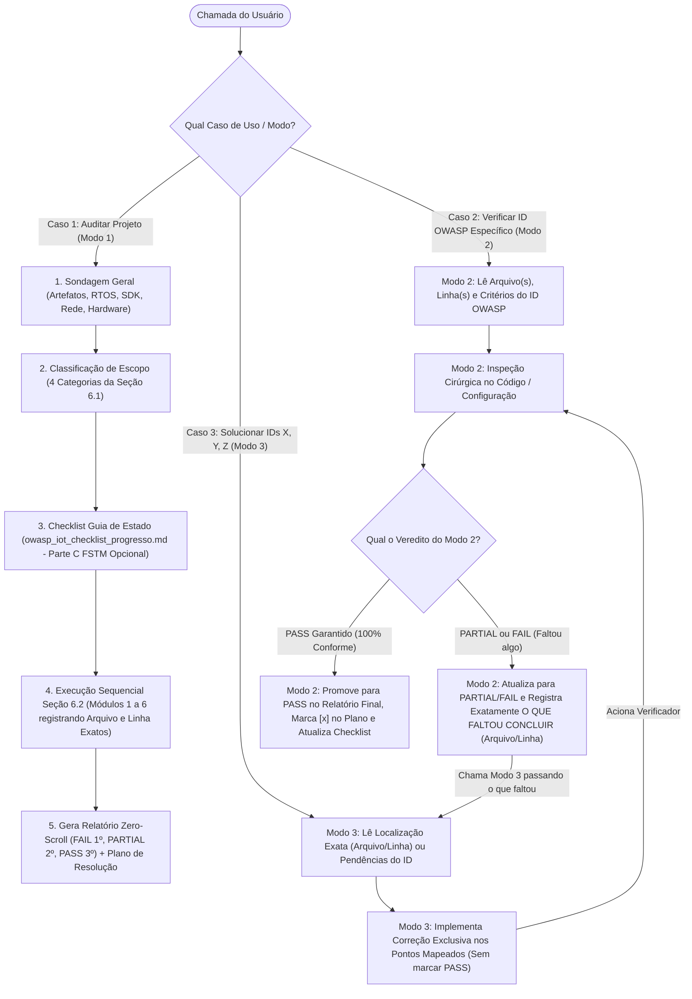
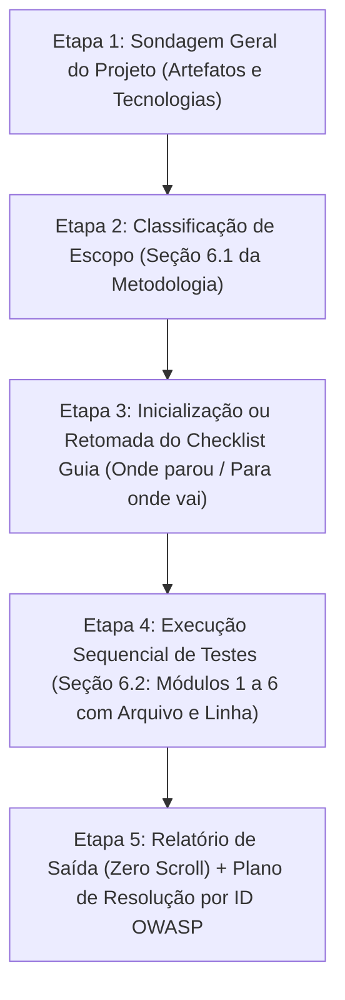
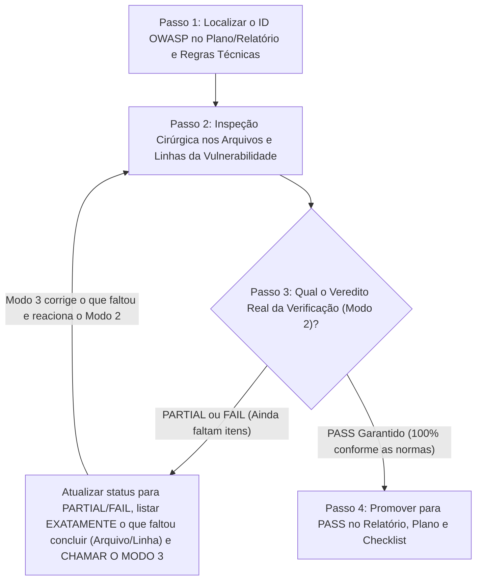
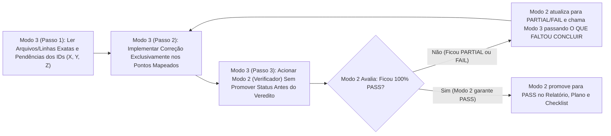

# OWASP IoT & Embedded Security Auditor Skill

Esta Skill instrui o agente a atuar em **três modos de operação complementares** para auditoria, reteste e resolução de segurança em sistemas embarcados e ecossistemas IoT, baseando-se na metodologia OWASP unificada descrita nesta própria Skill (**Seção 6.1** = classificação de escopo da **Etapa 2**; **Seção 6.2** = os 6 módulos de teste da **Etapa 4**) e nos repositórios oficiais OWASP usados como fonte em `IOT_OWASP/` (`embeddedappsec`, `owasp-fstm` e `owasp-istg`, incluídos como *git submodules*):

| Modo de Chamada | Quando Usar | Como Funciona / Como o Usuário Chama |
| :--- | :--- | :--- |
| **Modo 1 — Auditoria Completa / Incremental** | Para mapear o projeto, rodar os 6 módulos da Seção 6.2 (registrando arquivo e linha exatos) e gerar o Relatório Final + Plano de Resolução. | *"Audite este projeto com a skill owasp-iot-auditor"* |
| **Modo 2 — Verificação Pontual por ID OWASP (Juiz Estrito)** | Para retestar um `ID OWASP` específico. **Se o resultado for `PARTIAL` ou `FAIL`**, o Modo 2 registra exatamente o que faltou concluir e **chama o Modo 3 em loop** até garantir o `PASS`. | *"Verifique o ID `ISTG-FW-SCRT-003`"* ou *"Reteste `EMB-APPSEC-01`"* |
| **Modo 3 — Resolução por ID OWASP (Loop com Modo 2)** | Para solucionar os IDs OWASP `X, Y, Z`. O Modo 3 **nunca** assume `PASS` sozinho: aplica a correção e chama o **Modo 2**; se ficar `PARTIAL`, recebe do Modo 2 o que faltou e repete o loop até o Modo 2 garantir `PASS`. | *"Solucione os IDs OWASP `ISTG-FW-SCRT-003`, `EMB-APPSEC-01` e `ISTG-DES-CRYPT-001`"* |

### Fluxograma Geral de Arquitetura e Casos de Uso do Agente

---

## Modo 1: Fluxo Operacional de Auditoria Completa (5 Etapas)

Sempre que acionado para auditar um projeto embarcado/IoT por completo (ou retomar de onde parou), o agente **DEVE** seguir estritamente a ordem abaixo:

---

### Etapa 1: Sondagem Geral do Projeto (Discovery & Inventário Tecnológico)

Antes de executar qualquer teste de vulnerabilidade, faça uma varredura completa da estrutura de diretórios e arquivos do projeto-alvo para identificar todos os **artefatos** e **tecnologias** presentes:

1. **Execute o script auxiliar de sondagem** ou inspecione os diretórios:
   - **Windows (PowerShell nativo):** [owasp_iot_scanner.ps1](./scripts/owasp_iot_scanner.ps1)
     `powershell -ExecutionPolicy Bypass -File .agents/skills/owasp-iot-auditor/scripts/owasp_iot_scanner.ps1 -TargetDir <caminho_do_projeto> -InitChecklist`
   - **Linux/macOS (Python):** [owasp_iot_scanner.py](./scripts/owasp_iot_scanner.py)
     `python3 .agents/skills/owasp-iot-auditor/scripts/owasp_iot_scanner.py --target <caminho_do_projeto> --init-checklist`
2. **Inventarie explicitamente:**
   - **Linguagens e Código-Fonte:** C, C++, Assembly, Python, Lua, Shell scripts, JavaScript/TypeScript, HTML/CSS.
   - **RTOS / Sistema Operacional / SDK:** ESP-IDF, FreeRTOS, Zephyr, Arduino, PlatformIO, Linux Embarcado (Yocto, Buildroot, BusyBox, OpenWrt, AGL), Bare-metal.
   - **Arquitetura e Hardware Alvo:** ARM/Cortex-M/A, Xtensa (ESP32/ESP8266), RISC-V, MIPS, AVR, x86, barramentos (`UART`, `I2C`, `SPI`, `JTAG`, `SWD`), memórias (`Flash SPI`, `NVS`, `EEPROM`, `LittleFS`, `SquashFS`, `UBIFS`, `JFFS2`).
   - **Artefatos de Build, Bootloader e Imagens:** `CMakeLists.txt`, `Makefile`, `platformio.ini`, `sdkconfig`, `Kconfig`, U-Boot configs, arquivos `.bin`, `.elf`, `.hex`, `.uf2`, `.img`, `Dockerfile`.
   - **Bibliotecas Criptográficas e Protocolos de Rede/Rádio:** `mbedTLS`, `OpenSSL`, `wolfSSL`, `TinyCrypt`, `HTTP/REST`, `MQTT` (Mosquitto/Aedes/ESP-MQTT), `CoAP`, `WebSockets`, `Wi-Fi`, `BLE/Bluetooth`, `LoRaWAN`, `ZigBee`, `NFC/RFID`.

---

### Etapa 2: Classificação das Funcionalidades conforme a Seção 6.1

Com base nos artefatos encontrados na Etapa 1, classifique o projeto nas **4 categorias da Seção 6.1** (tabela abaixo) para ativar apenas os módulos e seções aplicáveis do checklist:

| Categoria (Seção 6.1) | Artefatos / Tecnologias Detectadas | Módulos e Componentes Ativados no Checklist |
| :--- | :--- | :--- |
| **1. Firmware / Código Embarcado** | Código C/C++, ESP-IDF, Arduino, PlatformIO, FreeRTOS, Zephyr, Linux embarcado | `ISTG-FW`, `ISTG-FW[INST]`, `ISTG-FW[UPDT]`, `ISTG-MEM`, `ISTG-PROC`, `ISTG-INT` (`UART`/`I2C`) e os 10 domínios do `Embedded AppSec` |
| **2. Sistema de Build / Imagem de Firmware** | `sdkconfig`, `platformio.ini`, `CMakeLists.txt`, `Makefile`, Yocto, Buildroot, `Dockerfile`, `.bin`/`.elf` | Hardening de Compilação (`ISTG-FW-INFO-004`), Superfície Mínima (`ISTG-FW-CONF-002`), Bootloader (`ISTG-FW[INST]-CRYPT-001`) e SBOM (`ISTG-FW-CONF-001`) |
| **3. Backend / Broker / Serviços de Dados** | Node.js/Express, Python/Flask/FastAPI, Brokers MQTT (Aedes/Mosquitto), APIs REST, CoAP, Bancos de Dados | `ISTG-DES` (Serviços de Troca de Dados) |
| **4. Aplicação Web / Painel / Mobile / Interfaces** | Frontend Web, Web UI embarcada (`/www`, `/htdocs`), App Mobile, Display/Botões, Interfaces Físicas/Wireless | `ISTG-UI` (Interfaces de Usuário), além de `ISTG-WRLS` (se houver rádio/Wi-Fi/BLE/RFID) e `ISTG-PHY` (se houver portas externas USB/Ethernet/SD) |

> [!IMPORTANT]
> Componentes que **não** existirem no projeto (por exemplo, `ISTG-UI` em um sensor headless sem interface de usuário, ou `ISTG-INT[I2C]` quando não há barramento I2C) devem ser marcados no checklist como `N/A` com a justificativa técnica correspondente.

---

### Etapa 3: Uso dos Checklists como Guia de Estado (Onde Parou e Para Onde Deve Ir)

O agente **DEVE** manter um arquivo de checklist de estado no projeto auditado (por padrão `owasp_iot_checklist_progresso.md`) baseado em:
- **Parte A (Obrigatória):** [checklists/checklist.md](../../../IOT_OWASP/owasp-istg/checklists/checklist.md) (casos de teste do OWASP ISTG);
- **Parte B (Obrigatória):** Os domínios do [OWASP Embedded Application Security](../../../IOT_OWASP/embeddedappsec/SUMMARY.md);
- **Parte C (OPCIONAL — Somente se o usuário pedir):** Os 9 estágios do [OWASP FSTM](../../../IOT_OWASP/owasp-fstm/README.md). Como o processo completo do FSTM (extração de binários, emulação e exploração em runtime) é longo e complexo, **NÃO deve ser executado por padrão**, permanecendo com status `OPCIONAL` a menos que o usuário solicite explicitamente.

#### Como operar o Checklist de Estado:
1. **Verifique se já existe um checklist em andamento** no projeto (`owasp_iot_checklist_progresso.md`).
   - **Se NÃO existir:** Copie a estrutura a partir do template consolidado [checklist_template.md](./resources/checklist_template.md), preenchendo o cabeçalho **"Estado Atual da Auditoria"** com a classificação da Seção 6.1, marcando os componentes fora de escopo como `N/A` e os aplicáveis (Partes A e B) como `PENDENTE` (mantendo a Parte C como `OPCIONAL`).
   - **Se JÁ existir:** Leia o bloco **"Estado Atual da Auditoria (Guia de Navegação do Agente)"** no topo do arquivo para identificar imediatamente:
     - **Onde o agente parou:** Último módulo da Seção 6.2 e último `Test ID` verificado;
     - **Para onde o agente deve ir:** Próximo módulo da Seção 6.2 e próximos `Test IDs` com status `PENDENTE` ou `EM_ANDAMENTO`.
2. **Atualização contínua:** Ao concluir cada módulo da Seção 6.2, atualize o status de cada item no checklist usando a nomenclatura padronizada:
   - `DE ACORDO (PASS)` — Controle implementado corretamente segundo a norma OWASP;
   - `PARCIALMENTE DE ACORDO (PARTIAL)` — Controle existe, mas é incompleto ou possui falhas parciais de implementação;
   - `EM DESACORDO (FAIL)` — Controle ausente ou vulnerabilidade confirmada;
   - `N/A` — Não aplicável à arquitetura/escopo do projeto;
   - `PENDENTE` — Ainda não verificado (indica para onde o agente deve ir a seguir);
   - `OPCIONAL` — Exclusivo para a Parte C (FSTM), executado somente sob pedido explícito do usuário.

---

### Etapa 4: Execução dos Testes e Verificações na Ordem da Seção 6.2

Execute as verificações técnicas **estritamente na sequência dos 6 Módulos da Seção 6.2** (definidos abaixo). Consulte as regras detalhadas e expressões regulares em [verification_rules.md](./references/verification_rules.md).

> [!IMPORTANT]
> **OBRIGATÓRIO (Rastreabilidade de Arquivo(s) e Linha(s) para o Agente Solucionador):**
> Durante a execução do **Modo 1** (e especialmente no **Módulo 1 — SAST Embarcado & Qualidade de Memória** e nos módulos subsequentes), sempre que uma vulnerabilidade ou não-conformidade (`FAIL` ou `PARTIAL`) for detectada, o agente **DEVE obrigatoriamente anotar TODAS as ocorrências exatas**, especificando **em qual(is) arquivo(s) e em qual(is) linha(s)** o problema se encontra (ex.: `[src/main.c:L42-L48](file:///caminho/absoluto/src/main.c#L42-L48)`, `[src/net.c:L115](file:///caminho/absoluto/src/net.c#L115)` + nome da função/chamada afetada).
> **Objetivo:** Minimizar ao máximo o esforço do agente que irá solucionar o problema (seja no Modo 3 ou um agente externo), permitindo que ele abra diretamente o arquivo e a linha exata sem precisar reescanear o código.

#### Ordem de Execução Obrigatória:

1. **Módulo 1 — SAST Embarcado & Qualidade de Memória**
   - **O que verificar (registrando sempre o(s) arquivo(s) e linha(s) exata(s) de cada ocorrência):**
     - Funções C/C++ banidas/inseguras (`gets`, `strcpy`, `strcat`, `sprintf`, `vsprintf`, `scanf("%s")` sem limite) e mau uso de `strncpy`/`strncat` com `strlen(src)`;
     - Vetores de *OS Command Injection* e *Code Injection* (`system`, `popen`, `exec*`, `os.execute`, `eval`, SQL sem *prepared statements*);
     - Limpeza segura de buffers sensíveis na RAM (`memset_s` / `mbedtls_platform_zeroize`, `mlock`, desativação de *core dumps*), controle de *Stack Overflow* (`configCHECK_FOR_STACK_OVERFLOW` no FreeRTOS) e *watchdog*.
   - **Registro Obrigatório para o Solucionador:** Liste cada chamada insegura encontrada com `[arquivo:L<inicio>-L<fim>](file:///caminho#L<inicio>-L<fim>)`, a função onde ocorre e o buffer/variável afetada.
   - **Itens do Checklist atualizados neste módulo:**
     - `EMB-APPSEC-01` (Buffer/Stack Overflow), `EMB-APPSEC-02` (Injection Prevention), `ISTG-PROC-LOGIC-001`, `ISTG-DES-INPV-001`, `ISTG-DES-INPV-002`, `ISTG-INT-INPV-001/002`, `ISTG-INT[I2C]-INPV-001`, `ISTG-INT[UART]-INPV-001`, `ISTG-PHY-INPV-001/002`, `ISTG-WRLS-INPV-001/002`, `ISTG-UI-INPV-001/002`.

2. **Módulo 2 — Segredos, Identidade e Criptografia (`SCRT`, `CRYPT`, `AUTHZ`)**
   - **O que verificar:**
     - Segredos *hardcoded* em código, headers `.h`, scripts ou binários (senhas Wi-Fi/MQTT, chaves privadas `.key`/`.pem`, tokens de API, credenciais padrão estáticas);
     - Proteção do `.gitignore` bloqueando `*.key`, `*.pem`, `*.csr`, `*.p12`, `.env`;
     - Configurações TLS/mTLS (TLS 1.2/1.3 obrigatório, `MBEDTLS_SSL_VERIFY_REQUIRED` / `rejectUnauthorized: true`, validação de CN/SAN, suítes AEAD AES-GCM/ChaCha20, sincronização NTP/RTC);
     - Armazenamento seguro de segredos e dados sensíveis (Flash Encryption, NVS Encryption, Secure Element/TPM, hashing forte com salt/bcrypt para senhas e UIDs RFID, política de complexidade de senha, lockout contra força bruta, gestão segura de sessão Web com `HttpOnly`/`Secure` e Privacy-by-Design / Factory Reset).
   - **Itens do Checklist atualizados neste módulo:**
     - `EMB-APPSEC-04`, `EMB-APPSEC-05`, `EMB-APPSEC-08`, `EMB-APPSEC-09`, `ISTG-MEM-SCRT-001`, `ISTG-MEM-CRYPT-001`, `ISTG-MEM-INFO-004`, `ISTG-FW-SCRT-001/002/003`, `ISTG-FW-CRYPT-001`, `ISTG-FW[INST]-AUTHZ-001/002`, `ISTG-FW[INST]-INFO-001`, `ISTG-DES-SCRT-001`, `ISTG-DES-CRYPT-001`, `ISTG-INT/PHY/WRLS/UI-AUTHZ-001/002`, `ISTG-INT/PHY/WRLS/UI-SCRT-001`, `ISTG-INT/PHY/WRLS/UI-CRYPT-001`, `ISTG-PROC-SIDEC-001`.

3. **Módulo 3 — Hardening de Build, Bootloader e Binários (`INFO-004`, `CONF-002`)**
   - **O que verificar:**
     - Flags de mitigação no compilador/toolchain (`-fPIE -pie`, `-fstack-protector-strong`/`all`, `-Wl,-z,noexecstack`, `-Wl,-z,relro,-z,now`, `-D_FORTIFY_SOURCE=2`) e verificação de binários ELF/PE (`checksec`/`readelf`);
     - Hardening de bootloader e SoC (U-Boot `CONFIG_ENABLE_VBOOT=y`, `CONFIG_FIT_SIGNATURE=y`, `CONFIG_BOOTDELAY=-2`, console silencioso; ESP-IDF `CONFIG_SECURE_BOOT_V2_ENABLED`, `CONFIG_SECURE_FLASH_ENC_ENABLED`, desativação de JTAG/ROM DL mode);
     - Redução de superfície (remoção de `telnetd`, `ftpd`, `gdbserver`, `strace`, múltiplos shells, código de debug/backdoors de fábrica CWE-489);
     - Auditoria de logs seriais (`Serial.print*`, `printf`, `ESP_LOG*`) para impedir vazamento de segredos, chaves, endereços de memória ou PII na `UART` (`ISTG-INT[UART]-INFO-002`) e bloqueio de console serial não autenticado (`ISTG-INT[UART]-AUTHZ-001/002`).
   - **Itens do Checklist atualizados neste módulo:**
     - `EMB-APPSEC-06`, `EMB-APPSEC-07`, `ISTG-PROC-AUTHZ-001/002`, `ISTG-MEM-INFO-001/002/003/005`, `ISTG-FW-INFO-001/002/003/004`, `ISTG-FW-CONF-002`, `ISTG-FW[INST]-CRYPT-001`, `ISTG-INT[UART]-AUTHZ-001/002`, `ISTG-INT[UART]-INFO-001/002`, `ISTG-INT[I2C]-AUTHZ-001`, `ISTG-INT[I2C]-INFO-001/002/003`, `ISTG-INT/PHY/WRLS/UI-INFO-001/002/003`, `ISTG-INT/PHY/WRLS/UI-CONF-002`.

4. **Módulo 4 — Ciclo de Vida de Atualização de Firmware (`ISTG-FW[UPDT]`)**
   - **O que verificar:**
     - Autenticação e autorização obrigatórias para acionar ou enviar atualização de firmware (`ISTG-FW[UPDT]-AUTHZ-001`);
     - Assinatura criptográfica assimétrica forte da imagem (RSA-2048/3072, ECDSA) e validação estrita no dispositivo **antes** da gravação/execução (`ISTG-FW[UPDT]-CRYPT-001`, `ISTG-FW[UPDT]-CRYPT-004`);
     - Criptografia da imagem de atualização em repouso/distribuição (`ISTG-FW[UPDT]-CRYPT-002`);
     - Transporte seguro do pacote OTA sobre HTTPS/MQTTS com validação de certificado X.509 (`ISTG-FW[UPDT]-CRYPT-003`);
     - Proteção *Anti-Rollback* (validação de versão semântica / contador monotônico em eFuse/hardware) e confirmação de partição A/B (`ISTG-FW[UPDT]-LOGIC-001`).
   - **Itens do Checklist atualizados neste módulo:**
     - `EMB-APPSEC-03`, `ISTG-FW[UPDT]-AUTHZ-001`, `ISTG-FW[UPDT]-CRYPT-001`, `ISTG-FW[UPDT]-CRYPT-002`, `ISTG-FW[UPDT]-CRYPT-003`, `ISTG-FW[UPDT]-CRYPT-004`, `ISTG-FW[UPDT]-LOGIC-001`.

5. **Módulo 5 — Serviços de Troca de Dados e Lógica de Negócio (`ISTG-DES`)**
   - **O que verificar:**
     - Autenticação e segregação de portas/protocolos entre interfaces administrativas Web e canais M2M/IoT (`ISTG-DES-AUTHZ-001`);
     - Controle de acesso horizontal e vertical (ACL de tópicos MQTT por dispositivo/sala amarrado ao CN/identidade do certificado X.509 — `ISTG-DES-AUTHZ-002`);
     - Ocultação de banners, versões e detalhes internos de ecossistema/rotas (`ISTG-DES-INFO-001/002/003`, `ISTG-DES-CONF-002`);
     - Proteções de lógica de negócio: anti-replay (timestamps/nonces), rate-limiting/cooldown no edge e no broker contra *flooding*, configuração de *Last Will and Testament (LWT)*, reconciliação de estado e logs de eventos críticos (`ISTG-DES-LOGIC-001`, `ISTG-INT/PHY/WRLS/UI-LOGIC-001`).
   - **Itens do Checklist atualizados neste módulo:**
     - `EMB-APPSEC-11` (Threat Modeling), `ISTG-DES-AUTHZ-001/002`, `ISTG-DES-INFO-001/002/003`, `ISTG-DES-CONF-002`, `ISTG-DES-LOGIC-001`, `ISTG-INT/PHY/WRLS/UI-LOGIC-001`.

6. **Módulo 6 — SBOM e Dependências de Terceiros (`CONF-001`)**
   - **O que verificar:**
     - Inventário completo (SBOM) de bibliotecas embarcadas (`platformio.ini`, `idf_component.yml`, submódulos C/C++, pacotes Linux) e dependências de backend/frontend (`package.json`, `requirements.txt`, etc.);
     - Verificação de versões fixadas (*pinned versions*), presença dos 7 elementos mínimos da CISA / ISVS V1.1.1 e correlação com CVEs conhecidas.
   - **Itens do Checklist atualizados neste módulo:**
     - `EMB-APPSEC-10`, `ISTG-FW-CONF-001`, `ISTG-DES-CONF-001`, `ISTG-INT-CONF-001`, `ISTG-PHY-CONF-001`, `ISTG-WRLS-CONF-001`, `ISTG-UI-CONF-001`.

---

### Etapa 5: Geração do Relatório de Saída (Sem Scroll) + Plano de Resolução (`owasp_iot_plano_resolucao.md`)

Após concluir a execução dos módulos (Módulos 1 a 6 da Seção 6.2) e atualizar o arquivo de checklist de estado (`owasp_iot_checklist_progresso.md`), o agente **DEVE** gerar **dois arquivos complementares** no projeto:

#### 5.1. Relatório Final de Saída (`owasp_iot_relatorio_final.md` — baseado em [report_template.md](./resources/report_template.md))

> [!CAUTION]
> **PROIBIDO MISTURAR STATUS NA MESMA TABELA NO RELATÓRIO DE SAÍDA:** O usuário **não** deve precisar fazer *scroll* por tabelas de componentes (`PROC`, `MEM`, `FW`, `DES`...) procurando quais itens falharam. O relatório de saída **DEVE** ser estruturado em seções exclusivas para cada categoria de conformidade, com um **Menu de Navegação Rápida (links âncora clicáveis)** no topo e colocando os itens reprovados primeiro:

1. **⚡ Menu de Navegação Rápida no Topo (Tabela com Quantidades + Links Diretos Clicáveis):**
   - Permite pular com 1 clique diretamente para a seção desejada (`FAIL`, `PARTIAL`, `PASS`, `N/A`, `Plano de Resolução`, `Sondagem`).
2. **❌ Seção 1 — Tópicos TOTALMENTE EM DESACORDO com as Normas (`FAIL` — Não Passaram no Teste):**
   - Posicionada **no topo do relatório** (logo abaixo do índice) para visualização imediata sem necessidade de *scroll*.
   - Reúne em uma única tabela todos os itens `FAIL` do checklist, com `ID OWASP`, `Módulo (6.2)`, `Componente`, `Tópico`, `Evidência Verificável (Arquivo/Linha)`, `Risco (STRIDE/CWE)` e `Recomendação de Correção`.
3. **⚠️ Seção 2 — Tópicos PARCIALMENTE DE ACORDO com as Normas (`PARTIAL`):**
   - Reúne em uma única seção dedicada todos os itens com mitigação parcial/incompleta, indicando claramente *o que já atende vs. o que falta* e a recomendação direta de ajuste.
4. **✅ Seção 3 — Tópicos DE ACORDO com as Normas (`PASS`):**
   - Reúne em sua própria seção dedicada todos os itens aprovados integralmente nos testes e suas respectivas evidências.
5. **⚪ Seção 4 — Tópicos Não Aplicáveis (`N/A`):**
   - Resumo compacto dos componentes/testes fora do escopo arquitetural do projeto.
6. **🔍 Seção 5 — Resumo da Sondagem Geral e Classificação (Seção 6.1):**
   - Artefatos/tecnologias detectadas e quais das 4 categorias da Seção 6.1 foram ativadas.

#### 5.2. Arquivo de Organização de Resoluções do Usuário (`owasp_iot_plano_resolucao.md` — baseado em [remediation_tracker_template.md](./resources/remediation_tracker_template.md))
- Crie o arquivo `owasp_iot_plano_resolucao.md` listando todos os itens `FAIL` (Prioridade Alta) e `PARTIAL` (Prioridade Média) como cards de tarefas (`[ ] <ID_OWASP> — <Nome>`) contendo:
  - O arquivo e linhas exatas onde o problema ocorre;
  - Um **Prompt pronto para copiar e colar** caso o usuário queira pedir para outro Agente Desenvolvedor corrigir aquela falha;
  - O **Comando pronto de Reteste Pontual por ID OWASP** (ex.: `"Verifique o ID ISTG-FW-SCRT-003"`) para o usuário chamar este Agente Verificador assim que a correção for concluída.

---

## Modo 2: Verificação Pontual / Reteste por ID OWASP (`Targeted ID Verification Mode`)

Quando o usuário (ou o próprio Modo 3) acionar o agente no **Modo 2** passando **um ou mais IDs OWASP específicos** (ex.: *"Verifique o ID `ISTG-FW-SCRT-003`"*, *"Reteste o `EMB-APPSEC-01` que acabei de corrigir"*), o agente **NÃO DEVE** reexecutar a auditoria completa (Etapas 1 a 5) e **JAMAIS deve assumir que uma tentativa de correção virou `PASS` automaticamente**.

Em vez disso, o **Modo 2** atua como **juiz estrito de conformidade** e, caso identifique que a correção ficou `PARTIAL` (ou permaneceu `FAIL`), **deve acionar o Modo 3 passando exatamente o que faltou concluir, mantendo esse loop até garantir o `PASS`**:

### Passo a Passo Obrigatório do Modo 2:

1. **Passo 1 — Localização do Contexto do `ID OWASP`:**
   - Leia o item correspondente ao `<ID_OWASP>` em `owasp_iot_plano_resolucao.md`, `owasp_iot_relatorio_final.md` e `owasp_iot_checklist_progresso.md` para identificar todos os arquivos e linhas afetados.
   - Consulte os critérios de aceite exatos daquele `<ID_OWASP>` em [verification_rules.md](./references/verification_rules.md) (ou execute o script auxiliar com `-VerifyId <ID_OWASP>` / `--verify-id <ID_OWASP>`).
2. **Passo 2 — Inspeção Cirúrgica no Código/Configuração:**
   - Inspecione diretamente todos os arquivos e linhas onde a vulnerabilidade estava localizada (e arquivos correlatos caso a lógica tenha sido movida/refatorada).
   - Verifique rigorosamente se **todas** as ocorrências foram corrigidas e se não restou mitigação incompleta (ex.: corrigiu `strcpy` em 2 arquivos mas esqueceu 1, ou trocou `strcpy` por `strncpy` sem garantir terminação nula `\0`, ou validou versão OTA no código mas esqueceu de ativar a flag no `sdkconfig`).
3. **Passo 3 — Veredito Estrito e Loop com o Modo 3 (Se `PARTIAL` ou `FAIL`):**
   - Classifique o estado real do `<ID_OWASP>`:
     - **Se o resultado for `⚠️ PARTIAL` (Parcialmente de Acordo) ou `❌ FAIL` (Totalmente em Desacordo):**
       1. **PROIBIDO promover para `PASS`!**
       2. Atualize o registro em `owasp_iot_relatorio_final.md` (movendo de `FAIL` para a seção `⚠️ PARTIAL`, se houve avanço parcial) e em `owasp_iot_plano_resolucao.md` registrando **exatamente o que faltou concluir (Arquivo(s), Linha(s) e requisito pendente)**.
       3. **Acione imediatamente o Modo 3 (Agente Solucionador)** — via `invoke_subagent` (`self`, `Role: "OWASP ID Remediator - Modo 3"`) ou execução direta do protocolo do Modo 3 — passando especificamente **o diagnóstico do que faltou concluir** para aquele `ID OWASP`.
       4. Após o Modo 3 aplicar a correção complementar, o Modo 2 reexecuta a inspeção cirúrgica (**Passo 2**). Esse **loop (`Modo 2` $\rightarrow$ `Modo 3` $\rightarrow$ `Modo 2`) deve continuar até que o Modo 2 garanta `✅ PASS`** *(exceto se houver impedimento físico de hardware externo impossível de resolver via software/configuração; nesse único caso, o loop encerra mantendo `⚠️ PARTIAL` nos 3 arquivos e explicando a limitação física ao usuário)*.
     - **Se e somente se o resultado for `✅ PASS` (100% De Acordo com as Normas):**
       - Prossiga para o **Passo 4**.
4. **Passo 4 — Promoção para `PASS` nos 3 Arquivos (Somente após Garantia do Modo 2):**
   - **`owasp_iot_plano_resolucao.md`:** Marque o checkbox como `[x]`, atualize o status para `🟢 Retestado e Aprovado (PASS)`, atualize o painel de contagem no topo e adicione uma linha na tabela **"3. Histórico de Problemas Resolvidos e Aprovados no Reteste"**.
   - **`owasp_iot_relatorio_final.md`:** Mova a linha do `<ID_OWASP>` da tabela `❌ FAIL` ou `⚠️ PARTIAL` para a tabela `✅ PASS` e atualize os contadores do **Menu de Navegação Rápida no Topo**.
   - **`owasp_iot_checklist_progresso.md`:** Atualize a coluna `Status` para `PASS` e `Notes / Evidências` com os arquivos e linhas verificados.
   - **No Chat:** Responda de forma objetiva mostrando o histórico das iterações (`FAIL` $\rightarrow$ `PARTIAL` $\rightarrow$ `PASS`), a evidência verificada e a confirmação de atualização dos arquivos.

---

## Modo 3: Resolução + Loop de Verificação por ID OWASP (`Targeted ID Remediation & Closed-Loop Verification`)

Quando o usuário (ou o Modo 2 durante um reteste incompleto) acionar o agente no **Modo 3** pedindo para **solucionar, corrigir ou resolver** um ou mais IDs OWASP específicos (`X, Y, Z`), o agente **NUNCA assume que sua própria correção virou `PASS` automaticamente**.

O **Modo 3** apenas implementa a solução técnica nos arquivos/linhas indicados e entrega para o **Modo 2 (Verificador)** julgar. Se o Modo 2 detectar que ficou `PARTIAL` (ou `FAIL`), o Modo 2 devolve para o Modo 3 passando **exatamente o que faltou concluir**, repetindo o ciclo em loop até o Modo 2 garantir `PASS`:

### Passo a Passo Obrigatório do Modo 3:

1. **Passo 1 — Leitura Focada dos IDs OWASP (`X, Y, Z`) ou do Delta Pendente Enviado pelo Modo 2:**
   - Se for a 1ª iteração: consulte `owasp_iot_plano_resolucao.md` e `owasp_iot_relatorio_final.md` para obter a **Localização Exata (`Arquivo(s)` e `Linha(s)`)** de todas as ocorrências do `ID OWASP`, além das regras em [verification_rules.md](./references/verification_rules.md).
   - Se for uma rechamada vinda do **Modo 2** (após resultado `PARTIAL` ou `FAIL`): leia exatamente a lista do **"que faltou concluir"** (arquivos, linhas e controles residuais apontados pelo Modo 2).
2. **Passo 2 — Implementação Exclusiva da Solução no Código/Configuração:**
   - Aplique as alterações de código, configuração de build ou scripts necessárias para sanar **todas** as ocorrências mapeadas dos IDs OWASP `X, Y, Z`, sem alterar partes não relacionadas do projeto.
   - **Regra Estrita:** O Modo 3 **NÃO** altera o status para `PASS` no relatório nem no checklist neste momento.
3. **Passo 3 — Chamada Obrigatória do Modo 2 e Loop até Garantir `PASS`:**
   - Concluída a edição do código, acione imediatamente o **Modo 2 (Verificação Pontual por ID OWASP)** (via subagente `self` com `Role: "OWASP ID Verifier - Modo 2"` ou executando estritamente os Passos 1 a 4 do Modo 2):
     - Se o **Modo 2** avaliar que a correção ficou **`⚠️ PARTIAL`** (ex.: resolveu parte dos arquivos ou apenas parte do requisito da norma) ou **`❌ FAIL`**, o **Modo 2** atualizará o status intermediário para `PARTIAL`/`FAIL` especificando **o que faltou concluir** e **chamará novamente o Modo 3** para corrigir o restante.
     - Esse **loop (`Modo 3` $\leftrightarrow$ `Modo 2`) continuará iterando** até que o **Modo 2** comprove que não há nenhuma pendência restante e emita o veredito final `✅ PASS`.
4. **Passo 4 — Consolidação Final pelo Modo 2:**
   - Somente quando o **Modo 2** garantir `✅ PASS`, os arquivos `owasp_iot_relatorio_final.md`, `owasp_iot_plano_resolucao.md` e `owasp_iot_checklist_progresso.md` terão o item promovido para `PASS`.
   - Apresente ao usuário o resumo das alterações aplicadas em cada iteração e a confirmação do veredito final do Modo 2.

