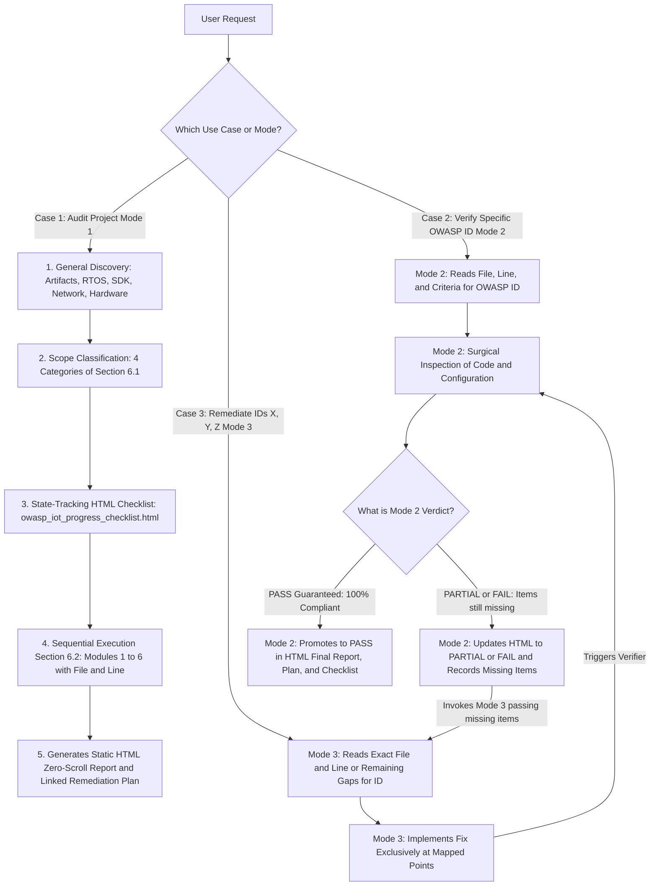
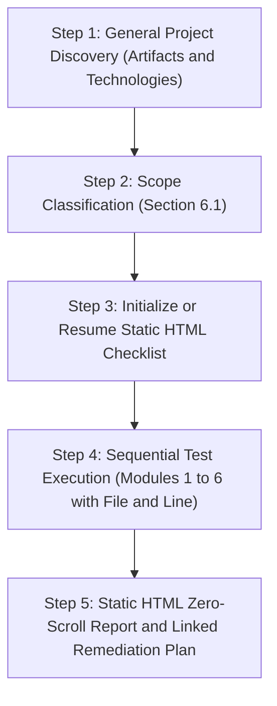
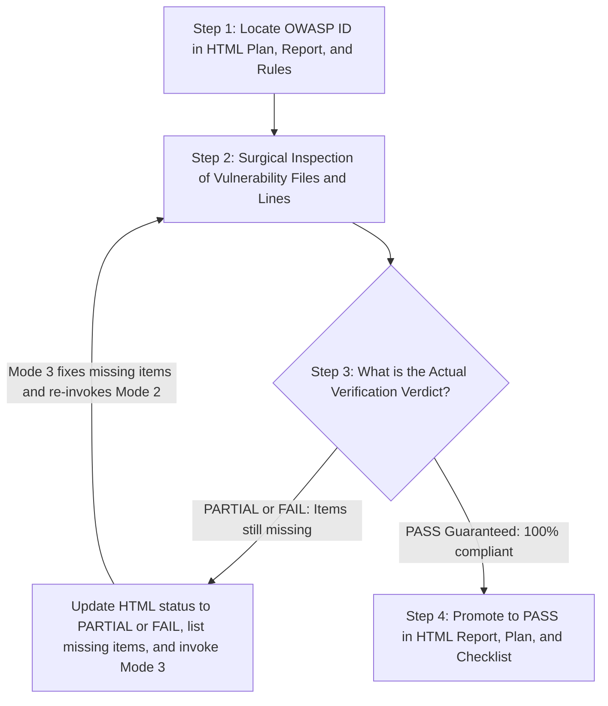
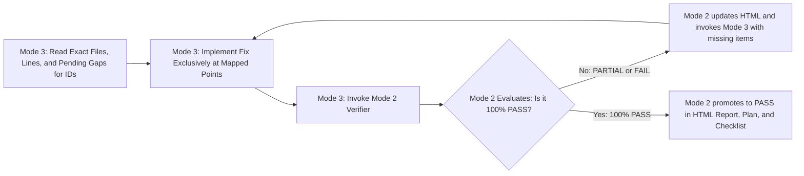

# OWASP IoT & Embedded Security Auditor Skill

> [!IMPORTANT]
> **General Output Rules (Language & Format Defaults):**
> 1. **English by Default:** All generated reports, remediation plans, and checklists **MUST be written in English by default**, regardless of the language used by the user in chat. Only write them in another language if the user **explicitly asks** for that language.
> 2. **Static HTML (`.html`) by Default for Single-Tab Browser Navigation:** By default, generate all three output artifacts as **standalone static HTML files** (`owasp_iot_final_report.html`, `owasp_iot_remediation_plan.html`, and `owasp_iot_progress_checklist.html`) using the templates in `./resources/`. All three pages share a unified top navigation bar and direct anchor links (`./owasp_iot_remediation_plan.html#<OWASP_ID>`) so the user can navigate between the Final Report, the Remediation Plan, and the Checklist inside a **single browser tab**. Only generate `.md` if explicitly requested by the user.

This Skill instructs the agent to operate in **three complementary operational modes** for security auditing, re-verification, and remediation across embedded systems and IoT ecosystems, based on the unified OWASP methodology described in this Skill (**Section 6.1** = scope classification in **Step 2**; **Section 6.2** = the 6 testing modules in **Step 4**) and the official OWASP repositories used as upstream sources in `IOT_OWASP/` (`embeddedappsec`, `owasp-fstm`, and `owasp-istg`, included as *git submodules*):

| Invocation Mode | When to Use | How It Works / How the User Invokes It |
| :--- | :--- | :--- |
| **Mode 1 — Full / Incremental Audit** | To map the project, run all 6 modules of Section 6.2 (recording exact file and line numbers), and generate the Static HTML Final Report + Linked Remediation Plan. | *"Audit this project with the owasp-iot-auditor skill"* |
| **Mode 2 — Targeted ID Verification (Strict Judge)** | To re-test a specific `OWASP ID`. **If the result is `PARTIAL` or `FAIL`**, Mode 2 records the exact missing items and **invokes Mode 3 in a loop** until `PASS` is guaranteed. | *"Verify ID `ISTG-FW-SCRT-003`"* or *"Re-test `EMB-APPSEC-01`"* |
| **Mode 3 — Targeted ID Remediation (Loop with Mode 2)** | To fix OWASP IDs `X, Y, Z`. Mode 3 **never** assumes `PASS` on its own: it applies the fix and invokes **Mode 2**; if `PARTIAL`, it receives the missing items from Mode 2 and repeats the loop until Mode 2 guarantees `PASS`. | *"Remediate OWASP IDs `ISTG-FW-SCRT-003`, `EMB-APPSEC-01`, and `ISTG-DES-CRYPT-001`"* |

### General Architecture & Agent Use-Case Flowchart

---

## Mode 1: Full Audit Operational Workflow (5 Steps)

Whenever invoked to audit an embedded/IoT project in full (or resume where it left off), the agent **MUST** strictly follow the sequence below:

---

### Step 1: General Project Discovery (Artifact & Technology Inventory)

Before running any vulnerability test, perform a complete scan of the target project's directory and file structure to identify all present **artifacts** and **technologies**:

1. **Run the helper discovery script** or inspect the directories:
   - **Cross-Platform (Python 3):** [owasp_iot_scanner.py](./scripts/owasp_iot_scanner.py)
     `python3 .agents/skills/owasp-iot-auditor/scripts/owasp_iot_scanner.py --target <project_path> --init-checklist`
2. **Explicitly inventory:**
   - **Languages & Source Code:** C, C++, Assembly, Python, Lua, Shell scripts, JavaScript/TypeScript, HTML/CSS.
   - **RTOS / Operating System / SDK:** ESP-IDF, FreeRTOS, Zephyr, Arduino, PlatformIO, Embedded Linux (Yocto, Buildroot, BusyBox, OpenWrt, AGL), Bare-metal.
   - **Target Architecture & Hardware:** ARM/Cortex-M/A, Xtensa (ESP32/ESP8266), RISC-V, MIPS, AVR, x86, buses (`UART`, `I2C`, `SPI`, `JTAG`, `SWD`), storage/memory (`SPI Flash`, `NVS`, `EEPROM`, `LittleFS`, `SquashFS`, `UBIFS`, `JFFS2`).
   - **Build Artifacts, Bootloader & Images:** `CMakeLists.txt`, `Makefile`, `platformio.ini`, `sdkconfig`, `Kconfig`, U-Boot configs, `.bin`, `.elf`, `.hex`, `.uf2`, `.img`, `Dockerfile`.
   - **Cryptographic Libraries & Network/Wireless Protocols:** `mbedTLS`, `OpenSSL`, `wolfSSL`, `TinyCrypt`, `HTTP/REST`, `MQTT` (Mosquitto/Aedes/ESP-MQTT), `CoAP`, `WebSockets`, `Wi-Fi`, `BLE/Bluetooth`, `LoRaWAN`, `ZigBee`, `NFC/RFID`.

---

### Step 2: Functionality Classification per Section 6.1

Based on the artifacts discovered in Step 1, classify the project across the **4 categories of Section 6.1** (table below) to activate only the applicable checklist modules and sections:

| Category (Section 6.1) | Detected Artifacts / Technologies | Activated Checklist Modules & Components |
| :--- | :--- | :--- |
| **1. Firmware / Embedded Code** | C/C++ code, ESP-IDF, Arduino, PlatformIO, FreeRTOS, Zephyr, Embedded Linux | `ISTG-FW`, `ISTG-FW[INST]`, `ISTG-FW[UPDT]`, `ISTG-MEM`, `ISTG-PROC`, `ISTG-INT` (`UART`/`I2C`), and the 10 `Embedded AppSec` domains |
| **2. Build System / Firmware Image** | `sdkconfig`, `platformio.ini`, `CMakeLists.txt`, `Makefile`, Yocto, Buildroot, `Dockerfile`, `.bin`/`.elf` | Compiler Hardening (`ISTG-FW-INFO-004`), Minimal Attack Surface (`ISTG-FW-CONF-002`), Bootloader (`ISTG-FW[INST]-CRYPT-001`), and SBOM (`ISTG-FW-CONF-001`) |
| **3. Backend / Broker / Data Services** | Node.js/Express, Python/Flask/FastAPI, MQTT Brokers (Aedes/Mosquitto), REST APIs, CoAP, Databases | `ISTG-DES` (Data Exchange Services) |
| **4. Web App / Dashboard / Mobile / Interfaces** | Web Frontend, Embedded Web UI (`/www`, `/htdocs`), Mobile App, Display/Buttons, Physical/Wireless Interfaces | `ISTG-UI` (User Interfaces), plus `ISTG-WRLS` (if Wi-Fi/BLE/RFID/radio is present) and `ISTG-PHY` (if external USB/Ethernet/SD ports exist) |

> [!IMPORTANT]
> Components that do **not** exist in the project (for example, `ISTG-UI` on a headless sensor with no user interface, or `ISTG-INT[I2C]` when no I2C bus is used) must be marked in the checklist as `N/A` with the corresponding technical justification.

---

### Step 3: Using Checklists as a State Guide (Where the Agent Stopped & Where to Go Next)

The agent **MUST** maintain a state-tracking static HTML checklist file in the audited project (by default `owasp_iot_progress_checklist.html`) based on:
- **Part A (Mandatory):** [checklists/checklist.md](../../../IOT_OWASP/owasp-istg/checklists/checklist.md) (OWASP ISTG test cases);
- **Part B (Mandatory):** The domains of [OWASP Embedded Application Security](../../../IOT_OWASP/embeddedappsec/SUMMARY.md);
- **Part C (OPTIONAL — Only if requested by the user):** The 9 stages of [OWASP FSTM](../../../IOT_OWASP/owasp-fstm/README.md). Because the full FSTM process (binary extraction, emulation, and runtime exploitation) is lengthy and complex, it **MUST NOT be executed by default**, remaining with status `OPTIONAL` unless explicitly requested by the user.

#### How to Operate the State-Tracking Checklist:
1. **Check whether an active checklist already exists** in the project (`owasp_iot_progress_checklist.html`).
   - **If it DOES NOT exist:** Copy the structure from the consolidated template [checklist_template.html](./resources/checklist_template.html), populating the **"Current Audit State"** header with the Section 6.1 classification, marking out-of-scope components as `N/A`, and applicable items (Parts A and B) as `PENDING` (keeping Part C as `OPTIONAL`).
   - **If it ALREADY exists:** Read the **"Current Audit State"** block at the top of `owasp_iot_progress_checklist.html` to immediately identify:
     - **Where the agent stopped:** Last completed Section 6.2 module and last verified `Test ID`;
     - **Where the agent must go next:** Next Section 6.2 module and next `Test IDs` with status `PENDING` or `IN_PROGRESS`.
2. **Continuous updating:** Upon completing each module of Section 6.2, update the status of every item in `owasp_iot_progress_checklist.html` using the standardized nomenclature:
   - `PASS` — Control properly implemented according to the OWASP standard;
   - `PARTIAL` — Control exists but is incomplete or has partial implementation flaws;
   - `FAIL` — Control missing or vulnerability confirmed;
   - `N/A` — Not applicable to the project's architecture/scope;
   - `PENDING` — Not yet verified (indicates where the agent must go next);
   - `OPTIONAL` — Exclusive to Part C (FSTM), executed only upon explicit user request.

---

### Step 4: Executing Tests & Verifications in Section 6.2 Order

Execute the technical verifications **strictly in the sequence of the 6 Modules of Section 6.2** (defined below). Consult the detailed criteria and regular expressions in [verification_rules.md](./references/verification_rules.md).

> [!IMPORTANT]
> **MANDATORY (Exact File(s) and Line(s) Traceability for the Remediator Agent):**
> During **Mode 1** execution (especially in **Module 1 — Embedded SAST & Memory Quality** and all subsequent modules), whenever a vulnerability or non-compliance (`FAIL` or `PARTIAL`) is detected, the agent **MUST mandatorily record ALL exact occurrences**, specifying **which file(s) and exact line number(s)** contain the issue (e.g., `<a href="file:///abs/path/src/main.c#L42-L48"><code>src/main.c:L42-L48</code></a>` + affected function/call name).
> **Objective:** Minimize the effort required by the remediating agent (whether in Mode 3 or an external agent), enabling it to open the exact file and line directly without rescanning the codebase.

#### Mandatory Execution Order:

1. **Module 1 — Embedded SAST & Memory Quality**
   - **What to verify (always recording the exact file(s) and line(s) of every occurrence):**
     - Banned/unsafe C/C++ functions (`gets`, `strcpy`, `strcat`, `sprintf`, `vsprintf`, unbounded `scanf("%s")`) and misuse of `strncpy`/`strncat` bounded by `strlen(src)`;
     - *OS Command Injection* and *Code Injection* vectors (`system`, `popen`, `exec*`, `os.execute`, `eval`, SQL queries without *prepared statements*);
     - Secure zeroization of sensitive buffers in RAM (`memset_s` / `mbedtls_platform_zeroize`, `mlock`, disabling *core dumps*), *Stack Overflow* protection (`configCHECK_FOR_STACK_OVERFLOW` in FreeRTOS), and hardware *watchdog*.
   - **Mandatory Record for the Remediator:** List every unsafe call found with `<a href="file:///path#L<start>-L<end>"><code>file:L<start>-L<end></code></a>`, the enclosing function, and the affected buffer/variable.
   - **Checklist items updated in this module:**
     - `EMB-APPSEC-01` (Buffer/Stack Overflow), `EMB-APPSEC-02` (Injection Prevention), `ISTG-PROC-LOGIC-001`, `ISTG-DES-INPV-001`, `ISTG-DES-INPV-002`, `ISTG-INT-INPV-001/002`, `ISTG-INT[I2C]-INPV-001`, `ISTG-INT[UART]-INPV-001`, `ISTG-PHY-INPV-001/002`, `ISTG-WRLS-INPV-001/002`, `ISTG-UI-INPV-001/002`.

2. **Module 2 — Secrets, Identity & Cryptography (`SCRT`, `CRYPT`, `AUTHZ`)**
   - **What to verify:**
     - *Hardcoded* secrets in source code, `.h` headers, scripts, or binaries (Wi-Fi/MQTT passwords, `.key`/`.pem` private keys, API tokens, static default credentials);
     - `.gitignore` protection blocking `*.key`, `*.pem`, `*.csr`, `*.p12`, `.env`;
     - TLS/mTLS configurations (mandatory TLS 1.2/1.3, `MBEDTLS_SSL_VERIFY_REQUIRED` / `rejectUnauthorized: true`, CN/SAN validation, AEAD cipher suites AES-GCM/ChaCha20, NTP/RTC time synchronization);
     - Secure storage of secrets and sensitive data (Flash Encryption, NVS Encryption, Secure Element/TPM, strong salted/bcrypt hashing for passwords and RFID UIDs, password complexity policy, brute-force lockout, secure web session management with `HttpOnly`/`Secure`, and Privacy-by-Design / Factory Reset).
   - **Checklist items updated in this module:**
     - `EMB-APPSEC-04`, `EMB-APPSEC-05`, `EMB-APPSEC-08`, `EMB-APPSEC-09`, `ISTG-MEM-SCRT-001`, `ISTG-MEM-CRYPT-001`, `ISTG-MEM-INFO-004`, `ISTG-FW-SCRT-001/002/003`, `ISTG-FW-CRYPT-001`, `ISTG-FW[INST]-AUTHZ-001/002`, `ISTG-FW[INST]-INFO-001`, `ISTG-DES-SCRT-001`, `ISTG-DES-CRYPT-001`, `ISTG-INT/PHY/WRLS/UI-AUTHZ-001/002`, `ISTG-INT/PHY/WRLS/UI-SCRT-001`, `ISTG-INT/PHY/WRLS/UI-CRYPT-001`, `ISTG-PROC-SIDEC-001`.

3. **Module 3 — Build, Bootloader & Binary Hardening (`INFO-004`, `CONF-002`)**
   - **What to verify:**
     - Compiler/toolchain mitigation flags (`-fPIE -pie`, `-fstack-protector-strong`/`all`, `-Wl,-z,noexecstack`, `-Wl,-z,relro,-z,now`, `-D_FORTIFY_SOURCE=2`) and ELF/PE binary verification (`checksec`/`readelf`);
     - Bootloader and SoC hardening (U-Boot `CONFIG_ENABLE_VBOOT=y`, `CONFIG_FIT_SIGNATURE=y`, `CONFIG_BOOTDELAY=-2`, silent console; ESP-IDF `CONFIG_SECURE_BOOT_V2_ENABLED`, `CONFIG_SECURE_FLASH_ENC_ENABLED`, disabling JTAG/ROM DL mode);
     - Attack surface reduction (removal of `telnetd`, `ftpd`, `gdbserver`, `strace`, extra shells, debug code/factory backdoors CWE-489);
     - Serial log audit (`Serial.print*`, `printf`, `ESP_LOG*`) to prevent leaking secrets, keys, memory addresses, or PII over `UART` (`ISTG-INT[UART]-INFO-002`) and blocking unauthenticated serial consoles (`ISTG-INT[UART]-AUTHZ-001/002`).
   - **Checklist items updated in this module:**
     - `EMB-APPSEC-06`, `EMB-APPSEC-07`, `ISTG-PROC-AUTHZ-001/002`, `ISTG-MEM-INFO-001/002/003/005`, `ISTG-FW-INFO-001/002/003/004`, `ISTG-FW-CONF-002`, `ISTG-FW[INST]-CRYPT-001`, `ISTG-INT[UART]-AUTHZ-001/002`, `ISTG-INT[UART]-INFO-001/002`, `ISTG-INT[I2C]-AUTHZ-001`, `ISTG-INT[I2C]-INFO-001/002/003`, `ISTG-INT/PHY/WRLS/UI-INFO-001/002/003`, `ISTG-INT/PHY/WRLS/UI-CONF-002`.

4. **Module 4 — Firmware Update Lifecycle (`ISTG-FW[UPDT]`)**
   - **What to verify:**
     - Mandatory authentication and authorization to trigger or upload a firmware update (`ISTG-FW[UPDT]-AUTHZ-001`);
     - Strong asymmetric cryptographic signature of the image (RSA-2048/3072, ECDSA) and strict on-device verification **before** flashing/execution (`ISTG-FW[UPDT]-CRYPT-001`, `ISTG-FW[UPDT]-CRYPT-004`);
     - Encryption of the firmware update image at rest/distribution (`ISTG-FW[UPDT]-CRYPT-002`);
     - Secure transport of the OTA package over HTTPS/MQTTS with X.509 certificate validation (`ISTG-FW[UPDT]-CRYPT-003`);
     - *Anti-Rollback* protection (semantic version check / monotonic counter in eFuse/hardware) and A/B partition boot confirmation (`ISTG-FW[UPDT]-LOGIC-001`).
   - **Checklist items updated in this module:**
     - `EMB-APPSEC-03`, `ISTG-FW[UPDT]-AUTHZ-001`, `ISTG-FW[UPDT]-CRYPT-001`, `ISTG-FW[UPDT]-CRYPT-002`, `ISTG-FW[UPDT]-CRYPT-003`, `ISTG-FW[UPDT]-CRYPT-004`, `ISTG-FW[UPDT]-LOGIC-001`.

5. **Module 5 — Data Exchange Services & Business Logic (`ISTG-DES`)**
   - **What to verify:**
     - Authentication and port/protocol segregation between administrative Web interfaces and M2M/IoT channels (`ISTG-DES-AUTHZ-001`);
     - Horizontal and vertical access control (per-device/per-room MQTT topic ACLs bound to the X.509 certificate CN/identity — `ISTG-DES-AUTHZ-002`);
     - Suppression of verbose banners, versions, and internal ecosystem/route details (`ISTG-DES-INFO-001/002/003`, `ISTG-DES-CONF-002`);
     - Business logic protections: anti-replay (timestamps/nonces), edge and broker rate-limiting/cooldown against *flooding*, *Last Will and Testament (LWT)* configuration, state reconciliation, and critical security event logging (`ISTG-DES-LOGIC-001`, `ISTG-INT/PHY/WRLS/UI-LOGIC-001`).
   - **Checklist items updated in this module:**
     - `EMB-APPSEC-11` (Threat Modeling), `ISTG-DES-AUTHZ-001/002`, `ISTG-DES-INFO-001/002/003`, `ISTG-DES-CONF-002`, `ISTG-DES-LOGIC-001`, `ISTG-INT/PHY/WRLS/UI-LOGIC-001`.

6. **Module 6 — SBOM & Third-Party Dependencies (`CONF-001`)**
   - **What to verify:**
     - Complete inventory (SBOM) of embedded libraries (`platformio.ini`, `idf_component.yml`, C/C++ submodules, Linux packages) and backend/frontend dependencies (`package.json`, `requirements.txt`, etc.);
     - Verification of *pinned versions*, presence of the 7 CISA / ISVS V1.1.1 minimum elements, and correlation against known CVEs.
   - **Checklist items updated in this module:**
     - `EMB-APPSEC-10`, `ISTG-FW-CONF-001`, `ISTG-DES-CONF-001`, `ISTG-INT-CONF-001`, `ISTG-PHY-CONF-001`, `ISTG-WRLS-CONF-001`, `ISTG-UI-CONF-001`.

---

### Step 5: Generating the Static HTML Zero-Scroll Output Report + Linked Remediation Plan (`owasp_iot_remediation_plan.html`)

After completing the execution of Modules 1 to 6 of Section 6.2 and updating the static HTML state-tracking checklist (`owasp_iot_progress_checklist.html`), the agent **MUST** generate **two cross-linked static HTML files** in the project (written in **English by default**, unless the user explicitly requested another language):

#### 5.1. Static HTML Final Output Report (`owasp_iot_final_report.html` — based on [report_template.html](./resources/report_template.html))

> [!CAUTION]
> **NEVER MIX STATUSES IN THE SAME TABLE IN THE OUTPUT REPORT:** The user must **not** have to scroll through component tables (`PROC`, `MEM`, `FW`, `DES`...) hunting for failed items. The static HTML report **MUST** be structured into dedicated sections for each compliance status, with a **Unified Top Navigation Bar** (linking to `./owasp_iot_remediation_plan.html` and `./owasp_iot_progress_checklist.html` in the same browser tab), **Quick Navigation Cards** at the top, and failed items placed first:

1. **⚡ Unified Top Bar + Quick Navigation Cards (Counts + Direct Clickable Links):**
   - Allows jumping with 1 click directly to the desired section (`#sec-fail`, `#sec-partial`, `#sec-pass`, `#sec-na`, `#sec-discovery`) or switching in the **same browser tab** to `./owasp_iot_remediation_plan.html` and `./owasp_iot_progress_checklist.html`.
2. **❌ Section 1 — Topics FULLY NON-COMPLIANT with Standards (`FAIL` — Failed the Test):**
   - Positioned **at the very top of the report** (right below the KPI cards) for immediate visibility without scrolling.
   - Consolidates all `FAIL` items from the checklist into a single HTML table (`#tbody-fail`) with `OWASP ID`, `Module (6.2)`, `Component`, `Checklist Topic`, `Exact Location (File(s) & Line(s)) + Evidence`, `Risk (STRIDE/CWE)`, and `Remediation & Action Link` (including `<a class="fix-link" href="./owasp_iot_remediation_plan.html#<OWASP_ID>">🛠️ Open in Remediation Plan &rarr;</a>`).
3. **⚠️ Section 2 — Topics PARTIALLY COMPLIANT with Standards (`PARTIAL`):**
   - Consolidates all items with partial/incomplete mitigation into `#tbody-partial`, clearly stating *what is already in place vs. what is missing*, the direct adjustment recommendation, and a link `<a class="fix-link" href="./owasp_iot_remediation_plan.html#<OWASP_ID>">🛠️ Open in Remediation Plan &rarr;</a>`.
4. **✅ Section 3 — Topics FULLY COMPLIANT with Standards (`PASS`):**
   - Consolidates all items that passed testing in full (`#tbody-pass`) along with their verified evidence.
5. **⚪ Section 4 — Not Applicable Topics (`N/A`):**
   - Compact summary (`#tbody-na`) of components/tests outside the architectural scope of the project.
6. **🔍 Section 5 — General Discovery & Scope Classification Summary (Section 6.1):**
   - Detected artifacts/technologies and which of the 4 categories of Section 6.1 were activated.

#### 5.2. Static HTML Remediation & Action Plan (`owasp_iot_remediation_plan.html` — based on [remediation_tracker_template.html](./resources/remediation_tracker_template.html))
- Create `owasp_iot_remediation_plan.html` listing all `FAIL` (High Priority) and `PARTIAL` (Medium Priority) items as actionable HTML cards (`<article class="remediation-card ..." id="<OWASP_ID>">`) containing:
  - Top navigation bar linking back to `./owasp_iot_final_report.html` and `./owasp_iot_progress_checklist.html` in the same browser tab;
  - The exact file(s) and line(s) where the issue occurs;
  - Interactive **Copy** buttons for:
    - **Direct Command (Mode 3):** `"Remediate OWASP ID <OWASP_ID>"`
    - **Ready-to-Copy Prompt for External Developer Agent**
    - **Standalone Re-test Command (Mode 2):** `"Verify ID <OWASP_ID>"`

---

## Mode 2: Targeted Single-ID Verification / Re-test (`Targeted ID Verification Mode`)

When the user (or Mode 3 itself) invokes the agent in **Mode 2** passing **one or more specific OWASP IDs** (e.g., *"Verify ID `ISTG-FW-SCRT-003`"*, *"Re-test `EMB-APPSEC-01` that I just fixed"*), the agent **MUST NOT** re-run the full audit (Steps 1 to 5) and **MUST NEVER assume that an attempted fix automatically became `PASS`**.

Instead, **Mode 2** acts as a **strict compliance judge** and, if it identifies that the fix is `PARTIAL` (or remains `FAIL`), **must invoke Mode 3 passing the exact missing items, maintaining this loop until `PASS` is guaranteed**:

### Mandatory Step-by-Step for Mode 2:

1. **Step 1 — Locate Context for `<OWASP_ID>`:**
   - Read the entry corresponding to `<OWASP_ID>` in `owasp_iot_remediation_plan.html`, `owasp_iot_final_report.html`, and `owasp_iot_progress_checklist.html` to identify all affected files and lines.
   - Consult the exact acceptance criteria for `<OWASP_ID>` in [verification_rules.md](./references/verification_rules.md) (or run the helper script with `--verify-id <OWASP_ID>`).
2. **Step 2 — Surgical Inspection of Code/Configuration:**
   - Directly inspect all files and lines where the vulnerability was located (and related files if the logic was moved/refactored).
   - Strictly verify whether **all** occurrences were fixed and no incomplete mitigation remains (e.g., fixed `strcpy` in 2 files but missed 1, replaced `strcpy` with `strncpy` without guaranteeing null termination `\0`, or validated OTA version in code but forgot to enable the flag in `sdkconfig`).
3. **Step 3 — Strict Verdict & Closed Loop with Mode 3 (If `PARTIAL` or `FAIL`):**
   - Classify the actual state of `<OWASP_ID>`:
     - **If the result is `⚠️ PARTIAL` (Partially Compliant) or `❌ FAIL` (Fully Non-Compliant):**
       1. **DO NOT promote to `PASS`!**
       2. Update the record in `owasp_iot_final_report.html` (moving from `#tbody-fail` to `#tbody-partial` if partial progress was made) and in `owasp_iot_remediation_plan.html`, recording **the exact missing items (File(s), Line(s), and pending requirement)**.
       3. **Immediately invoke Mode 3 (Remediator Agent)** — via `invoke_subagent` (`self`, `Role: "OWASP ID Remediator - Mode 3"`) or direct execution of the Mode 3 protocol — passing specifically **the diagnosis of what still needs to be completed** for that `OWASP ID`.
       4. After Mode 3 applies the complementary fix, Mode 2 re-runs the surgical inspection (**Step 2**). This **loop (`Mode 2` $\rightarrow$ `Mode 3` $\rightarrow$ `Mode 2`) must continue until Mode 2 guarantees `✅ PASS`** *(except if there is an external physical hardware limitation impossible to resolve via software/configuration; in that sole case, the loop ends while keeping `⚠️ PARTIAL` across all 3 HTML files and explaining the physical limitation to the user)*.
     - **If and only if the result is `✅ PASS` (100% Compliant with Standards):**
       - Proceed to **Step 4**.
4. **Step 4 — Promotion to `PASS` Across All 3 HTML Files (Only After Mode 2 Guarantees It):**
   - **`owasp_iot_remediation_plan.html`:** Mark the card checkbox as checked (`<input type="checkbox" checked>`), update the badge to `PASS`, update the top KPI counters (`#rem-count-fail`, `#rem-count-partial`, `#rem-count-pass`), and append a row to `#tbody-resolved-history`.
   - **`owasp_iot_final_report.html`:** Move the `<OWASP_ID>` row from `#tbody-fail` or `#tbody-partial` to `#tbody-pass` and update the top KPI counters (`#count-fail`, `#count-partial`, `#count-pass`).
   - **`owasp_iot_progress_checklist.html`:** Update the `Status` cell to `<code>PASS</code>` and `Notes / Evidence` with the verified files and lines.
   - **In Chat:** Reply concisely showing the iteration history (`FAIL` $\rightarrow$ `PARTIAL` $\rightarrow$ `PASS`), the verified evidence, and confirmation that all HTML tracking files were updated.

---

## Mode 3: Targeted ID Remediation & Closed-Loop Verification (`Targeted ID Remediation & Closed-Loop Verification`)

When the user (or Mode 2 during an incomplete re-test) invokes the agent in **Mode 3** asking to **remediate, fix, or resolve** one or more specific OWASP IDs (`X, Y, Z`), the agent **NEVER assumes its own fix automatically became `PASS`**.

**Mode 3** only implements the technical fix at the indicated files/lines and hands it over to **Mode 2 (Verifier)** for judgment. If Mode 2 detects that it is `PARTIAL` (or `FAIL`), Mode 2 returns it to Mode 3 passing **the exact missing items**, repeating the cycle in a loop until Mode 2 guarantees `PASS`:

### Mandatory Step-by-Step for Mode 3:

1. **Step 1 — Focused Reading of OWASP IDs (`X, Y, Z`) or Remaining Delta Sent by Mode 2:**
   - If 1st iteration: consult `owasp_iot_remediation_plan.html` and `owasp_iot_final_report.html` to obtain the **Exact Location (`File(s)` and `Line(s)`)** of all occurrences of the `OWASP ID`, plus the rules in [verification_rules.md](./references/verification_rules.md).
   - If re-invoked by **Mode 2** (after a `PARTIAL` or `FAIL` verdict): read the exact list of **"missing items to complete"** (files, lines, and residual controls pointed out by Mode 2).
2. **Step 2 — Exclusive Implementation of the Fix in Code/Configuration:**
   - Apply the code, build configuration, or script changes required to remediate **all** mapped occurrences of OWASP IDs `X, Y, Z`, without altering unrelated parts of the project.
   - **Strict Rule:** Mode 3 **DOES NOT** change the status to `PASS` in the HTML report or checklist at this stage.
3. **Step 3 — Mandatory Invocation of Mode 2 & Loop Until `PASS` is Guaranteed:**
   - Once code edits are complete, immediately invoke **Mode 2 (Targeted ID Verification)** (via the `self` subagent with `Role: "OWASP ID Verifier - Mode 2"` or by strictly executing Steps 1 to 4 of Mode 2):
     - If **Mode 2** determines that the fix is **`⚠️ PARTIAL`** (e.g., fixed only some files or part of the requirement) or **`❌ FAIL`**, **Mode 2** will update the intermediate status to `PARTIAL`/`FAIL` specifying **what still needs to be completed** and **will invoke Mode 3 again** to fix the remainder.
     - This **loop (`Mode 3` $\leftrightarrow$ `Mode 2`) continues iterating** until **Mode 2** confirms no pending gaps remain and issues the final `✅ PASS` verdict.
4. **Step 4 — Final Consolidation by Mode 2:**
   - Only when **Mode 2** guarantees `✅ PASS` will `owasp_iot_final_report.html`, `owasp_iot_remediation_plan.html`, and `owasp_iot_progress_checklist.html` have the item promoted to `PASS`.
   - Present a summary of the changes applied across each iteration and the confirmation of Mode 2's final verdict to the user.
