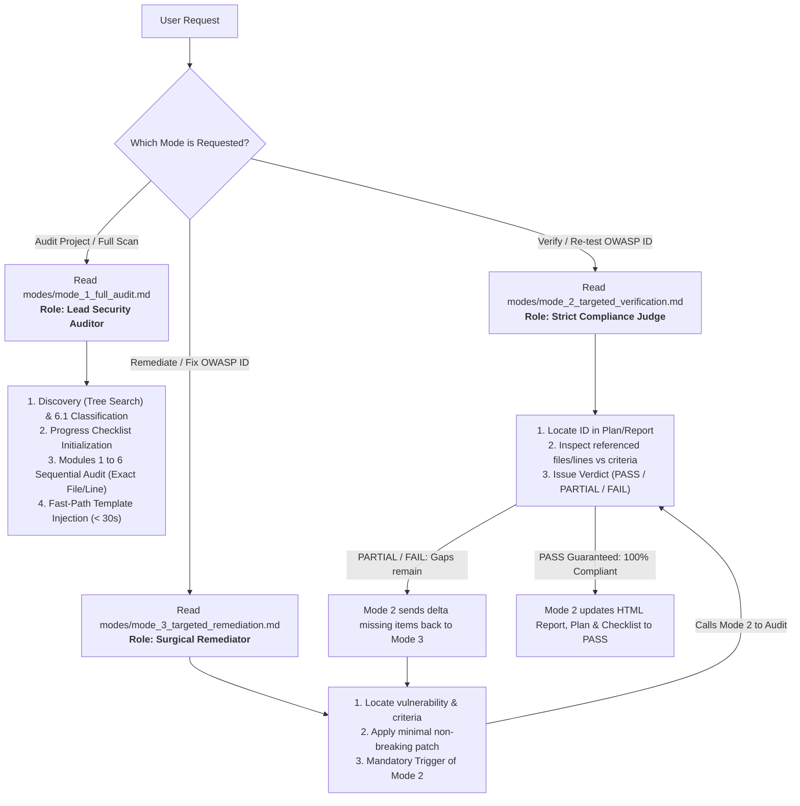

# OWASP IoT & Embedded Security Auditor Skill (Master Router)

> [!IMPORTANT]
> **Universal Defaults & Immutable HTML Skeleton:**
> 1. **Default Language — English:** All generated reports, remediation plans, and checklists **MUST be written in English by default**.
> 2. **Default Output Format — Static HTML (`.html`) for Single-Tab Navigation:** Outputs are standalone static HTML files (`owasp_iot_final_report.html`, `owasp_iot_remediation_plan.html`, and `owasp_iot_progress_checklist.html`) sharing a unified top navigation bar.
> 3. **🔒 Immutable HTML Skeleton & Anchor Preservation:** The HTML structure (`<head>`, `<style>`, `<nav>`, `<section>`, `<thead>`, CSS classes, `<script>`) is **100% FROZEN**. When inserting findings at declared anchors (`<!-- ANCHOR: ... -->`), **ALWAYS preserve the anchor comment** in `ReplacementContent` (or use `owasp_iot_scanner.py --inject-anchor`) so subsequent findings and re-tests never lose the insertion anchor. Never rewrite 400+ lines of HTML from scratch.

---

## 1. Modular 3-Mode Architecture

To minimize reading latency and maximize token efficiency, this Skill routes requests to **three dedicated, specialized mode documents**:

| Mode | Agent Persona / Role | When to Use | Execution Guide |
| :--- | :--- | :--- | :--- |
| **Mode 1** | **Lead Security Auditor** | Full project mapping, Section 6.1 discovery/classification, sequential Module 1–6 SAST/Secrets/Hardening/OTA/DES/SBOM audit with exact file/line mapping, and Fast-Path HTML report generation. | 👉 [modes/mode_1_full_audit.md](./modes/mode_1_full_audit.md) |
| **Mode 2** | **Strict Compliance Judge** | Surgical re-test of specific OWASP IDs. Impartially verifies against acceptance criteria, enforces closed loop with Mode 3 if gaps remain, and holds exclusive authority to promote items to `PASS`. | 👉 [modes/mode_2_targeted_verification.md](./modes/mode_2_targeted_verification.md) |
| **Mode 3** | **Surgical Remediator & Patch Engineer** | Applies clean, non-breaking security patches to specific OWASP IDs. Never marks `PASS` on its own; immediately triggers Mode 2 and loops until 100% compliance is certified. | 👉 [modes/mode_3_targeted_remediation.md](./modes/mode_3_targeted_remediation.md) |

---

## 2. Master Operational Architecture & Routing Flowchart

---

## 3. On-Demand Heavy Knowledge & Tooling Index (Level 3 Assets)

When operating within any of the three modes, consult these specialized assets strictly as needed via tool calls:

- **Surgical Regex & Acceptance Criteria:** [`references/verification_rules.md`](./references/verification_rules.md) (contains regular expressions and technical criteria for all 86 ISTG test cases and Embedded AppSec domains).
- **High-Performance Tree Scanner Helper:** [`scripts/owasp_iot_scanner.py`](./scripts/owasp_iot_scanner.py) (single-pass tree search with `os.scandir` for `--init-all`, discovery, and `--verify-id`).
- **Pre-Built Static HTML Templates:**
  - Final Audit Report: [`resources/report_template.html`](./resources/report_template.html)
  - Remediation Action Plan: [`resources/remediation_tracker_template.html`](./resources/remediation_tracker_template.html)
  - State-Tracking Checklist: [`resources/checklist_template.html`](./resources/checklist_template.html)
