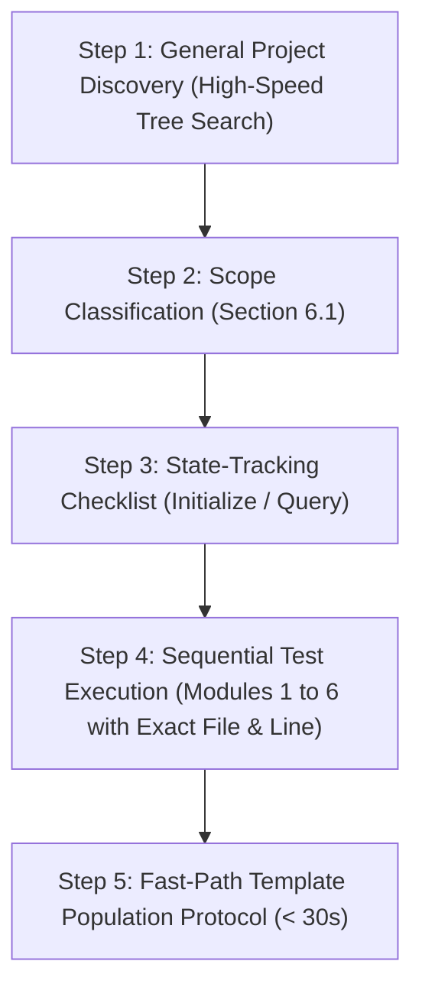

# Mode 1: Full / Incremental Project Audit

> **Agent Persona / Role:** **Lead Security Auditor**  
> **Trigger Prompts:** *"Audit this project with the owasp-iot-auditor skill"*, *"Run a full OWASP IoT security audit"*, *"Resume audit from checklist"*.  
> **Output Deliverables:** `owasp_iot_progress_checklist.html`, `owasp_iot_final_report.html`, and `owasp_iot_remediation_plan.html`.

---

## 1. Role & Operational Mandate

As the **Lead Security Auditor**, your mission is to perform an end-to-end, thorough, and disciplined security assessment of the target embedded/IoT project following the unified OWASP standard (**Section 6.1** for functionality classification and **Section 6.2 Modules 1 to 6** for test execution).

### 🌐 Mandatory Output Defaults:
1. **Universal English Standard:** All generated reports, plans, and checklists **MUST be written in English by default**, regardless of the language the user uses in chat.
2. **Static HTML Single-Tab Output:** By default, generate all three output artifacts as **standalone static HTML files** linked via the unified top navigation bar (`./owasp_iot_final_report.html` $\leftrightarrow$ `./owasp_iot_remediation_plan.html` $\leftrightarrow$ `./owasp_iot_progress_checklist.html`).
3. **🔒 Immutable HTML Skeleton Rule:**
   - The HTML skeleton is **100% FROZEN/IMMUTABLE**: NEVER alter layout, `<head>`, `<style>`, `<nav>`, `<section>`, `<thead>`, CSS classes, or `<script>` tags.
   - Modifications are permitted **EXCLUSIVELY** at declared anchor comments (`<!-- ANCHOR: ... -->`) and KPI counter spans.
   - **Never rewrite 400+ lines of HTML from scratch.**

---

## 2. Mode 1 Operational Workflow (5 Sequential Steps)



---

### Step 1: General Project Discovery (Technology & Artifact Inventory)

1. **Run the high-performance discovery helper script** (single-pass tree search):
   ```bash
   python3 .agents/skills/owasp-iot-auditor/scripts/owasp_iot_scanner.py --target . --init-all
   ```
2. **Explicitly inventory present technologies:**
   - **Languages & Code:** C, C++, Assembly, Python, Shell, JavaScript/TypeScript, HTML/CSS.
   - **RTOS / OS / SDK:** ESP-IDF, FreeRTOS, Zephyr, Arduino, PlatformIO, Embedded Linux, Bare-metal.
   - **Target Architecture & Hardware Interfaces:** ARM Cortex-M/A, Xtensa (ESP32), RISC-V, AVR, UART, I2C, SPI, JTAG/SWD.
   - **Build Artifacts & Bootloader:** `CMakeLists.txt`, `Makefile`, `platformio.ini`, `sdkconfig`, U-Boot configs, `.bin`, `.elf`.
   - **Protocols, Storage & Crypto:** `mbedTLS`, `OpenSSL`, `MQTT`, `HTTP/REST`, `CoAP`, `Wi-Fi`, `BLE`, `NVS`, `LittleFS`, `SPIFFS`.

---

### Step 2: Functionality Classification per Section 6.1

Classify the target project across the 4 categories of Section 6.1 to activate the relevant checklist modules:

| Category (Section 6.1) | Detected Artifacts / Technologies | Activated Checklist Modules & Components |
| :--- | :--- | :--- |
| **1. Firmware / Embedded Code** | C/C++ code, ESP-IDF, Arduino, PlatformIO, FreeRTOS, Zephyr, Embedded Linux | `ISTG-FW`, `ISTG-FW[INST]`, `ISTG-FW[UPDT]`, `ISTG-MEM`, `ISTG-PROC`, `ISTG-INT` (`UART`/`I2C`), and the 10 `Embedded AppSec` domains |
| **2. Build System / Firmware Image** | `sdkconfig`, `platformio.ini`, `CMakeLists.txt`, `Makefile`, `Dockerfile`, `.bin`/`.elf` | Compiler Hardening (`ISTG-FW-INFO-004`), Minimal Surface (`ISTG-FW-CONF-002`), Bootloader (`ISTG-FW[INST]-CRYPT-001`), and SBOM (`ISTG-FW-CONF-001`) |
| **3. Backend / Broker / Data Services** | Node.js, Python, MQTT Brokers (Mosquitto/Aedes), REST APIs, Databases | `ISTG-DES` (Data Exchange Services) |
| **4. Web App / Dashboard / Interfaces** | Web Frontend, Embedded Web UI (`/www`, `/htdocs`), Mobile App, Wireless/Physical ports | `ISTG-UI` (User Interfaces), `ISTG-WRLS` (Wi-Fi/BLE/RFID), `ISTG-PHY` (USB/Ethernet) |

> [!NOTE]
> Components outside project scope must be marked as `N/A` with technical justification.

---

### Step 3: State-Tracking Checklist (`owasp_iot_progress_checklist.html`)

1. **Check if checklist exists:** Initialized in Step 1 via `--init-all` from [`checklist_template.html`](../resources/checklist_template.html).
2. **Maintain State Guide:**
   - **Where the agent stopped:** Last completed Section 6.2 module and last verified `Test ID`.
   - **Where the agent must go next:** Next pending module and `Test IDs`.
3. **Status Standardization:** `PASS`, `PARTIAL`, `FAIL`, `N/A`, `PENDING`, `OPTIONAL` (exclusive to Part C FSTM).

---

### Step 4: Sequential Test Execution (Section 6.2 Order)

> [!CRITICAL]
> **MANDATORY TRACEABILITY FOR REMEDIATION (Exact File(s) and Line(s)):**
> For every vulnerability or non-compliance (`FAIL` or `PARTIAL`), the agent **MUST record the exact file(s) and line number(s)** (`file:///abs/path#L<start>-L<end>`) along with the enclosing function and evidence snippet.

#### Execution Sequence:

1. **Module 1 — Embedded SAST & Memory Quality**
   - Unsafe C/C++ buffer functions (`gets`, `strcpy`, `strcat`, `sprintf`, `vsprintf`, unbounded `scanf`).
   - Command/Code Injection (`system`, `popen`, `exec*`, `eval`).
   - Buffer zeroization (`memset_s`, `mbedtls_platform_zeroize`), stack overflow detection, hardware watchdog.
   - *Target IDs:* `EMB-APPSEC-01/02`, `ISTG-*-INPV-001/002`.

2. **Module 2 — Secrets, Identity & Cryptography (`SCRT`, `CRYPT`, `AUTHZ`)**
   - Hardcoded credentials, private keys (`.key`, `.pem`), API tokens in code or configs.
   - `.gitignore` protection blocking sensitive files.
   - TLS/mTLS validation (`MBEDTLS_SSL_VERIFY_REQUIRED`, `rejectUnauthorized: true`, CN/SAN check).
   - Weak crypto (MD5, SHA1, DES, RC4, ECB mode) and secure storage (NVS encryption, Flash Encryption).
   - *Target IDs:* `EMB-APPSEC-04/05/08/09`, `ISTG-*-SCRT-*`, `ISTG-*-CRYPT-*`.

3. **Module 3 — Build, Bootloader & Binary Hardening (`INFO-004`, `CONF-002`)**
   - Compiler flags (`-fstack-protector-strong`, `-fPIE -pie`, `-Wl,-z,relro,-z,now`, `-D_FORTIFY_SOURCE=2`).
   - Secure Boot & Flash Encryption configurations (`CONFIG_SECURE_BOOT_V2_ENABLED`, U-Boot `CONFIG_FIT_SIGNATURE`).
   - Attack surface reduction (removal of telnetd, ftpd, debug code, backdoors CWE-489).
   - Serial UART log leakage (`Serial.print*`, `printf`, `ESP_LOG*` dumping secrets/tokens).
   - *Target IDs:* `EMB-APPSEC-06/07`, `ISTG-FW-INFO-004`, `ISTG-FW-CONF-002`, `ISTG-INT[UART]-*`.

4. **Module 4 — Firmware Update Lifecycle (`ISTG-FW[UPDT]`)**
   - Authentication/authorization for firmware updates (`ISTG-FW[UPDT]-AUTHZ-001`).
   - Asymmetric cryptographic signature & on-device verification before flashing (`ISTG-FW[UPDT]-CRYPT-001/004`).
   - Encrypted transmission (HTTPS/MQTTS) and Anti-Rollback protection (eFuse/hardware monotonic counter).
   - *Target IDs:* `EMB-APPSEC-03`, `ISTG-FW[UPDT]-*`.

5. **Module 5 — Data Exchange Services & Business Logic (`ISTG-DES`)**
   - Authentication segregation (admin Web UI vs M2M IoT traffic).
   - Topic ACLs (per-device authorization, restricting `#` wildcards).
   - Anti-replay (timestamps, nonces), rate limiting/cooldown against flooding, LWT configuration.
   - *Target IDs:* `EMB-APPSEC-11`, `ISTG-DES-*`.

6. **Module 6 — SBOM & Third-Party Dependencies (`CONF-001`)**
   - Inventory of manifests (`platformio.ini`, `idf_component.yml`, `package.json`, `requirements.txt`).
   - Pinned versions, verification of known CVEs.
   - *Target IDs:* `EMB-APPSEC-10`, `ISTG-*-CONF-001`.

---

### Step 5: ⚡ Fast-Path Template Population Protocol (< 30 Seconds)

> [!IMPORTANT]
> **Strictly Immutable Skeleton Rule:**
> 1. Copy templates via `python3 .../owasp_iot_scanner.py --target . --init-all`.
> 2. Perform **single-batch replacements** using `replace_file_content` targeting ONLY the declared anchors (`<!-- ANCHOR: ... -->`).
> 3. Zero structural changes to CSS, headers, layout, or script tags.

#### Anchor Injection Mapping:

| Target File | Target Section | Anchor Comment | What to Inject |
| :--- | :--- | :--- | :--- |
| **`owasp_iot_final_report.html`** | Header / KPIs | Replace `<PROJECT_NAME>`, `<YYYY-MM-DD>`, counts | Project metadata & counts |
| **`owasp_iot_final_report.html`** | Section 1 (`#sec-fail`) | `<!-- ANCHOR: INSERT_FAIL_ROWS_HERE -->` | Formatted `<tr>` rows for `FAIL` items |
| **`owasp_iot_final_report.html`** | Section 2 (`#sec-partial`) | `<!-- ANCHOR: INSERT_PARTIAL_ROWS_HERE -->` | Formatted `<tr>` rows for `PARTIAL` items |
| **`owasp_iot_final_report.html`** | Section 3 (`#sec-pass`) | `<!-- ANCHOR: INSERT_PASS_ROWS_HERE -->` | Formatted `<tr>` rows for `PASS` items |
| **`owasp_iot_final_report.html`** | Section 4 (`#sec-na`) | `<!-- ANCHOR: INSERT_NA_ROWS_HERE -->` | Formatted `<tr>` rows for `N/A` items |
| **`owasp_iot_final_report.html`** | Section 5 (`#sec-discovery`) | `<!-- ANCHOR: INSERT_DISCOVERY_DETAILS_HERE -->` | Discovery details & 6.1 activation table |
| **`owasp_iot_remediation_plan.html`** | Header / KPIs | Replace `<PROJECT_NAME>`, `<YYYY-MM-DD HH:MM>`, counts | Project metadata & counts |
| **`owasp_iot_remediation_plan.html`** | Queue 1 (FAIL) | `<!-- ANCHOR: INSERT_FAIL_CARDS_HERE -->` | `<article class="remediation-card fail-card">` cards |
| **`owasp_iot_remediation_plan.html`** | Queue 2 (PARTIAL) | `<!-- ANCHOR: INSERT_PARTIAL_CARDS_HERE -->` | `<article class="remediation-card partial-card">` cards |
| **`owasp_iot_progress_checklist.html`** | State Header | `<!-- ANCHOR: AUDIT_STATE_LIST -->` | Current audit position and next pending step |
| **`owasp_iot_progress_checklist.html`** | Test Tables | `<td><code>PENDING</code></td>` | Replace with badge (`FAIL`/`PARTIAL`/`PASS`/`N/A`) + notes |

#### Injected Row & Card Snippets:

##### `FAIL` Table Row for `owasp_iot_final_report.html`:
```html
<tr id="row-<OWASP_ID>">
  <td><code><OWASP_ID></code></td>
  <td><code>Module <N></code></td>
  <td><code><Component></code></td>
  <td><Topic Name></td>
  <td><a href="file:///<abs_path>#L<start>-L<end>"><code><rel_path>:L<start>-L<end></code></a> (<Evidence/Snippet>)</td>
  <td><Risk STRIDE/CWE></td>
  <td>
    <Remediation Summary><br>
    <a class="fix-link" href="./owasp_iot_remediation_plan.html#<OWASP_ID>">🛠️ Open in Remediation Plan &rarr;</a>
  </td>
</tr>
```

##### `FAIL` Remediation Card for `owasp_iot_remediation_plan.html`:
```html
<article class="remediation-card fail-card" id="<OWASP_ID>">
  <div class="card-header">
    <h3 class="card-title">
      <input type="checkbox">
      <code><OWASP_ID></code> &mdash; <Topic Name>
    </h3>
    <span class="badge badge-fail">❌ FAIL (Awaiting Remediation)</span>
  </div>
  <p><strong>Module (6.2) / Component:</strong> <code>Module <N> / <Component></code></p>
  <p><strong>📍 Exact Location (File(s) &amp; Line(s)):</strong></p>
  <ul>
    <li><a href="file:///<abs_path>#L<start>-L<end>"><code><rel_path>:L<start>-L<end></code></a> &mdash; Function <code><func_name>()</code>: <Snippet/Evidence></li>
  </ul>
  <p><strong>Issue Description:</strong> <Objective explanation of the vulnerability found></p>
  <p><strong>What Needs to Be Done (OWASP Acceptance Criteria):</strong> <Exact replacement/fix required at each file and line listed above></p>

  <div><strong>⚡ Direct Command (Mode 3 &mdash; This Agent Remediates + Self-Verifies + Marks PASS):</strong></div>
  <div class="cmd-block">
    <span>Remediate OWASP ID <OWASP_ID></span>
    <button class="copy-btn" onclick="copyCmd(this)">Copy</button>
  </div>

  <div><strong>📋 Ready-to-Copy Prompt for External Developer Agent (Option B &mdash; Zero Search Effort):</strong></div>
  <div class="cmd-block">
    <span>Fix vulnerability <OWASP_ID> (<Topic Name>) at <rel_path>:L<start>-L<end> in function <func_name>(): <secure_fix_description>.</span>
    <button class="copy-btn" onclick="copyCmd(this)">Copy</button>
  </div>

  <div><strong>🔍 Standalone Re-test Command (Mode 2 &mdash; If fixed externally):</strong></div>
  <div class="cmd-block">
    <span>Verify ID <OWASP_ID></span>
    <button class="copy-btn" onclick="copyCmd(this)">Copy</button>
  </div>
</article>
```
