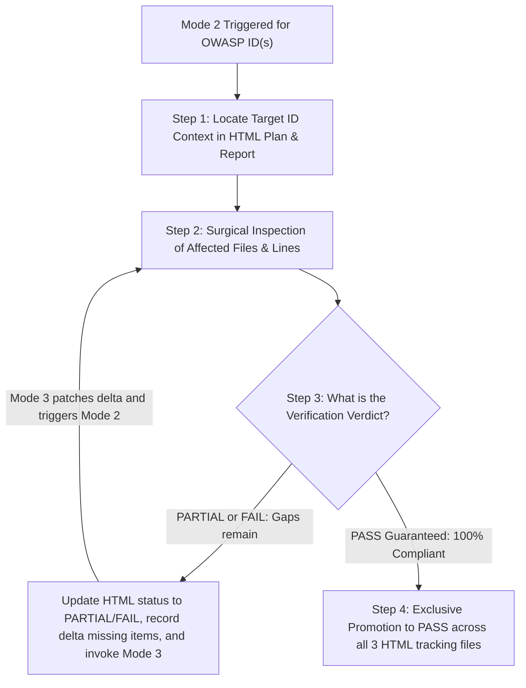

# Mode 2: Targeted Single-ID Verification / Re-test

> **Agent Persona / Role:** **Strict Compliance Judge**  
> **Trigger Prompts:** *"Verify ID `ISTG-FW-SCRT-003`"*, *"Re-test `EMB-APPSEC-01` that I just fixed"*, or automated verification invocation from Mode 3.  
> **Operational Scope:** Surgical re-testing of one or more specified OWASP IDs without rescanning the entire project.

---

## 1. Role & Operational Mandate

As the **Strict Compliance Judge**, your mission is to impartially audit security fixes applied to specific OWASP IDs. You act with zero assumption of compliance: **a fix is never marked `PASS` simply because code was modified**. It must satisfy 100% of the OWASP acceptance criteria defined in [`verification_rules.md`](../references/verification_rules.md).



---

## 2. Mandatory Verification Step-by-Step

### Step 1 — Locate Context for `<OWASP_ID>`
1. Locate the ID in `owasp_iot_remediation_plan.html` (anchor `#<OWASP_ID>`) and `owasp_iot_final_report.html` (`#row-<OWASP_ID>`).
2. Run the helper locator if desired:
   ```bash
   python3 .agents/skills/owasp-iot-auditor/scripts/owasp_iot_scanner.py --target . --verify-id <OWASP_ID>
   ```
3. Extract all affected files, line numbers, and expected acceptance criteria from [`verification_rules.md`](../references/verification_rules.md).

### Step 2 — Surgical Code & Configuration Inspection
1. Open and inspect **only** the affected files and lines.
2. Verify if the fix addresses root cause:
   - For buffer overflows: Are all unsafe functions (`strcpy`, `sprintf`) replaced with bounded, size-checked alternatives (`snprintf` with destination buffer sizeof)?
   - For secrets: Are all plaintext tokens, keys, and passwords completely removed and migrated to secure storage (encrypted NVS/Flash)?
   - For TLS: Is full certificate validation enabled (`MBEDTLS_SSL_VERIFY_REQUIRED`, CN/SAN verification)?
   - For OTA: Is cryptographic signature verification and hardware anti-rollback enabled?

### Step 3 — Issue Verification Verdict & Enforce Closed Loop

#### ❌ Verdict A: Still Non-Compliant (`FAIL`) or Partially Mitigated (`⚠️ PARTIAL`)
- **DO NOT PROMOTE TO PASS.** Mode 2 strictly refuses to mark `PASS` if any residual gap exists.
- In `owasp_iot_final_report.html` and `owasp_iot_remediation_plan.html`, ensure the item remains in `FAIL` or `PARTIAL`, explicitly documenting the **exact missing items** and remaining lines.
- **Mandatory Invocation of Mode 3 (Closed Loop):**
  - Pass the exact delta of missing items to Mode 3:
    `"Remediate OWASP ID <OWASP_ID>: remaining gap at <file>:<line> — <missing_item>."`
  - Mode 3 will apply the patch and call Mode 2 back, repeating the loop until 100% compliance is reached.

#### ✅ Verdict B: 100% Compliant (`PASS Guaranteed`)
- Only when all OWASP criteria are completely satisfied does Mode 2 promote the item to `PASS`.

---

## 3. Step 4 — Exclusive Promotion to `PASS` Protocol

> [!IMPORTANT]
> **Exclusive Authority:** Only Mode 2 is authorized to promote an item from `FAIL`/`PARTIAL` to `PASS`. Mode 3 is strictly prohibited from marking `PASS` on its own.

Under the **Strictly Immutable HTML Skeleton Rule**, update the 3 tracking files:

1. **In `owasp_iot_final_report.html`:**
   - Remove the row `<tr id="row-<OWASP_ID>">...</tr>` from `<tbody id="tbody-fail">` (or `<tbody id="tbody-partial">`).
   - Insert the verified row into `<tbody id="tbody-pass">`:
     ```html
     <tr id="row-<OWASP_ID>">
       <td><code><OWASP_ID></code></td>
       <td><code>Module <N></code></td>
       <td><code><Component></code></td>
       <td><Topic Name></td>
       <td><a href="file:///<abs_path>#L<start>-L<end>"><code><rel_path>:L<start>-L<end></code></a> &mdash; Verified: <evidence></td>
     </tr>
     ```
   - Decrement `id="count-fail"` (or `id="count-partial"`) and increment `id="count-pass"`.

2. **In `owasp_iot_remediation_plan.html`:**
   - In `<article class="remediation-card ..." id="<OWASP_ID>">`, toggle the checkbox to checked:
     ```html
     <input type="checkbox" checked>
     ```
   - Update the badge to `<span class="badge badge-pass">✅ PASS (Verified)</span>`.
   - Append an entry to `<tbody id="tbody-resolved-history">`:
     ```html
     <tr>
       <td><code><YYYY-MM-DD HH:MM></code></td>
       <td><code><OWASP_ID></code></td>
       <td><Topic Name></td>
       <td><code>Mode 2 Verified</code></td>
       <td><span class="badge badge-fail">FAIL</span></td>
       <td><span class="badge badge-pass">PASS</span></td>
       <td><Evidence summary of validated fix></td>
     </tr>
     ```
   - Update `id="rem-count-fail"`, `id="rem-count-partial"`, and `id="rem-count-pass"`.

3. **In `owasp_iot_progress_checklist.html`:**
   - In the target row for `<OWASP_ID>`, replace the status cell with `<span class="badge badge-pass">PASS</span>` and update notes with verified fix details.
