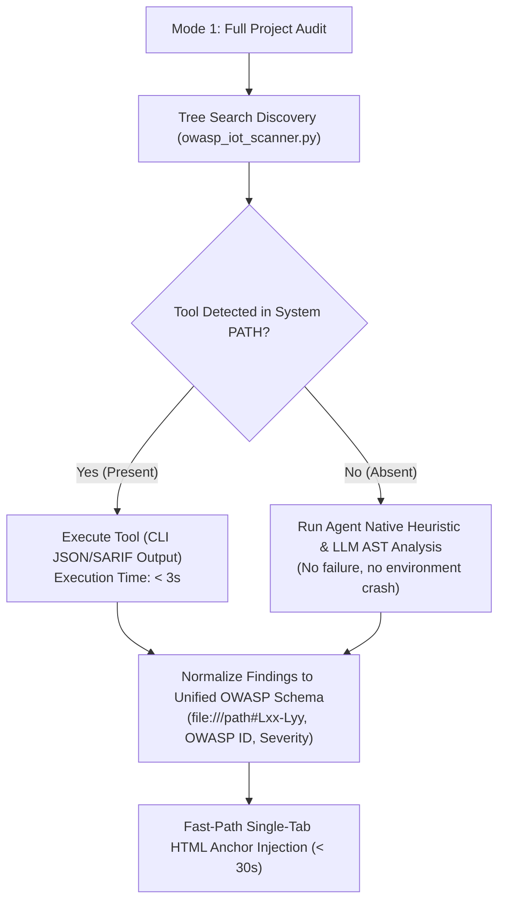

# Static Analysis Tools Reference — OWASP IoT & Embedded Security Auditor

> [!NOTE]
> **Operational Scope Notice:**
> The current development and execution scope of this agent is strictly focused on **Static Analysis (SAST, Secret Scanning, SCA, and Binary Hardening Inspection)** performed directly on the target source code repository, headers, build configurations, and compiled artifacts.
> **Dynamic Analysis (DAST, e.g., OWASP ZAP, live device network fuzzing, runtime API testing) is explicitly deferred to future development phases.**

---

## 1. Overview & Integration Philosophy

To maintain maximum speed, deterministic findings, and zero external dependency friction, third-party static tools operate under a **Plug-and-Play with Graceful Degradation** model:



- **Zero Blocking Requirements:** If a tool is not installed on the host machine, the audit does **not fail**. The agent falls back seamlessly to its internal Python parser and LLM reasoning.
- **Speed Guarantee:** External CLI invocations must terminate in `< 15 seconds` and output structured data (JSON, SARIF, or custom formatted templates).
- **Exact Line Traceability:** Findings must provide file paths and line ranges (`file:///abs/path#Lxx-Lyy`) to feed directly into `owasp_iot_final_report.html` and `owasp_iot_remediation_plan.html`.

---

## 2. Recommended Static Analysis Tools Catalog

### 2.1. Cppcheck — Deep C/C++ Semantic SAST
* **Core Function:** Syntax and semantic flow analysis for C and C++ without requiring a complete compilation environment or target hardware toolchain.
* **Target Vulnerabilities:** Buffer overflows (stack/heap), use-after-free, double free, null pointer dereferences, integer overflows, memory leaks, and uninitialized variables.
* **OWASP Mapping:**
  - *Module 1: Memory Safety & Buffer Overflow Protections* (OWASP Embedded AppSec #1)
  - *Module 2: Logic Flaws & Pointer Safety* (OWASP Embedded AppSec #2)
  - Compliance Addons: **MISRA C:2012** and **CERT C**.
* **Recommended CLI Command:**
  ```bash
  cppcheck --enable=warning,style,performance,portability \
           --inline-suppr \
           --template="{file}:{line}:{severity}:{id}:{message}" \
           --quiet \
           <target_source_directory>
  ```
* **Performance Profile:** 2 to 8 seconds for typical embedded micro-controller codebases.

---

### 2.2. Gitleaks — Ultra-Fast Secret & Key Detection
* **Core Function:** High-performance regex and entropy-based scanner written in Go, compiled to a single static binary.
* **Target Vulnerabilities:** Hardcoded cryptographic keys (RSA, ECC, PEM blocks), Wi-Fi SSIDs/passwords, MQTT broker credentials, AWS/Azure IoT tokens, API secrets, and basic authentication strings in source and configuration headers.
* **OWASP Mapping:**
  - *Module 3: Authentication, Credentials & Secrets* (OWASP Embedded AppSec #3)
  - *ISTG-FW-SCRT-001/002/003* (Insecure credential and key storage)
* **Recommended CLI Command:**
  ```bash
  gitleaks dir --source <target_directory> --report-format json --report-path gitleaks_results.json --verbose
  ```
* **Performance Profile:** < 2 seconds for full directory trees.

---

### 2.3. Semgrep (OSS Engine) — AST Pattern Matching for IoT APIs
* **Core Function:** Semantic pattern matching using Abstract Syntax Trees (AST) evaluated against custom YAML rulesets.
* **Target Vulnerabilities:** Insecure IoT API usage patterns, banned C functions (`strcpy`, `sprintf`, `gets`, `scanf`), disabled TLS certificate validation (`mbedtls_ssl_conf_authmode(&conf, MBEDTLS_SSL_VERIFY_NONE)`), plain-text protocol usage, and unauthenticated command handlers.
* **OWASP Mapping:**
  - *Module 4: Insecure Network & Communications Security* (OWASP Embedded AppSec #4)
  - *Module 5: Cryptography Implementation Weaknesses* (OWASP Embedded AppSec #5)
* **Recommended CLI Command:**
  ```bash
  semgrep scan --config <custom_iot_rules.yaml> --json --output semgrep_results.json <target_directory>
  ```
* **Performance Profile:** 3 to 10 seconds.

---

### 2.4. Flawfinder — Lexical C/C++ Security Linter
* **Core Function:** Python-based lexical analyzer that parses C/C++ code line-by-line looking for functions historically prone to security vulnerabilities, scoring each finding from risk level 1 to 5 with corresponding CWE mappings.
* **Target Vulnerabilities:** Classic buffer overflows (CWE-120), format string vulnerabilities (CWE-134), race conditions (CWE-362), and improper input validation.
* **OWASP Mapping:**
  - *Module 1: Memory Safety & Buffer Overflow Protections*
* **Recommended CLI Command:**
  ```bash
  flawfinder --dataonly --minlevel=2 --sarif <target_directory>
  ```
* **Performance Profile:** < 1 second. Can be distributed as a simple Python module (`pip install flawfinder`).

---

### 2.5. Checksec / Py-Checksec — Compiled Binary Hardening Inspector
* **Core Function:** Inspects compiled ELF binaries (located in `build/` or output artifact folders) to verify compiler-level exploit mitigations.
* **Target Vulnerabilities:** Missing compile-time protections on embedded Linux or RTOS ELF targets.
  - **NX / DEP:** Non-Executable stack and heap (`W^X`).
  - **Stack Canaries:** Protection against stack frame overwrites.
  - **PIE / ASLR:** Position Independent Executable for address space randomization.
  - **RELRO:** Read-Only Relocations to protect the Global Offset Table (GOT).
* **OWASP Mapping:**
  - *Module 2: Firmware & Binary Hardening* (OWASP Embedded AppSec #2 / FSTM)
* **Recommended CLI Command:**
  ```bash
  checksec --format=json --file=<path_to_binary.elf>
  # Alternatively via Python pwntools:
  # python -c "from pwn import ELF; print(ELF('<path_to_binary.elf>').checksec())"
  ```
* **Performance Profile:** < 1 second per binary.

---

### 2.6. Trivy (Aqua Security) / Grype — Software Composition Analysis (SCA)
* **Core Function:** Comprehensive scanner for known Common Vulnerabilities and Exposures (CVEs) in third-party libraries, submodules, vendor SDKs, and embedded packages.
* **Target Vulnerabilities:** Outdated third-party components (e.g., vulnerable versions of cJSON, mbedTLS, FreeRTOS, lwIP, busybox, curl).
* **OWASP Mapping:**
  - *Module 6: Third-Party Components & Supply Chain Security* (OWASP Embedded AppSec #6)
* **Recommended CLI Command:**
  ```bash
  trivy fs --format json --output trivy_results.json <target_directory>
  ```
* **Performance Profile:** 5 to 15 seconds.

---

## 3. Comparison Matrix & Evaluation Summary

| Tool | Core Domain | OWASP Module Focus | Execution Speed | Primary Output Format | Setup Overhead |
| :--- | :--- | :--- | :--- | :--- | :--- |
| **Cppcheck** | Deep C/C++ AST/Flow SAST | Modules 1, 2 | 2 – 8 sec | JSON / XML / Template | Low (native binary) |
| **Gitleaks** | Secrets & Hardcoded Keys | Module 3 | < 2 sec | JSON / SARIF | Very Low (single binary) |
| **Semgrep** | IoT API Patterns & Insecure Calls | Modules 4, 5 | 3 – 10 sec | JSON / SARIF | Low (`pip` or binary) |
| **Flawfinder**| Lexical C/C++ Security Linter | Module 1 | < 1 sec | SARIF / CSV / Text | Very Low (`pip` package) |
| **Checksec** | ELF Binary Exploit Hardening | Module 2 (Binary) | < 1 sec | JSON / Text | Very Low (Python/Go) |
| **Trivy** | Third-Party Dependencies (SCA) | Module 6 | 5 – 15 sec | JSON | Low (single binary) |

---

## 4. Integration Blueprint for `owasp_iot_scanner.py`

When the agent executes **Mode 1 (Full Project Audit)**, the helper script `owasp_iot_scanner.py` can orchestrate external tool execution as follows:

```python
# Conceptual Workflow in scripts/owasp_iot_scanner.py
def run_optional_sast_tools(target_path: str) -> dict:
    findings = {"secrets": [], "memory_safety": [], "cves": []}
    
    # 1. Check Gitleaks
    if shutil.which("gitleaks"):
        findings["secrets"] = run_gitleaks(target_path)
        
    # 2. Check Cppcheck
    if shutil.which("cppcheck"):
        findings["memory_safety"] = run_cppcheck(target_path)
        
    # 3. Check Trivy
    if shutil.which("trivy"):
        findings["cves"] = run_trivy(target_path)
        
    return findings
```

All findings are mapped into standard HTML finding rows (`<tr>`) and injected directly into `owasp_iot_final_report.html` through the immutable skeleton anchors (`<!-- ANCHOR: INSERT_FAIL_ROWS_HERE -->`).
