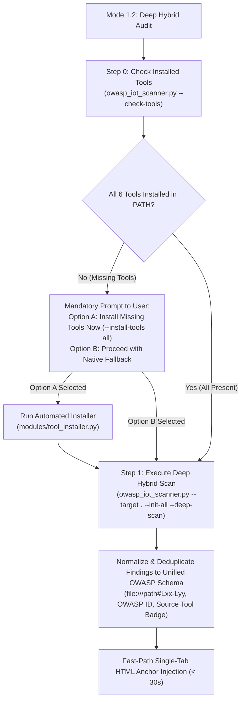

# Static Analysis Tools Reference — OWASP IoT & Embedded Security Auditor (Mode 1.2)

> [!NOTE]
> **Operational Scope Notice:**
> The current development and execution scope of this agent is strictly focused on **Static Analysis (SAST, Secret Scanning, SCA, and Binary Hardening Inspection)** performed directly on the target source code repository, headers, build configurations, and compiled artifacts.
> **Dynamic Analysis (DAST, e.g., OWASP ZAP, live device network fuzzing, runtime API testing) is explicitly deferred to future development phases.**

---

## 1. Overview & Mode 1.2 Integration Philosophy

When executing **Mode 1.2 (Deep Hybrid Audit — Full-Power SAST + OWASP)**, the agent combines 100% of its native OWASP engine with the 6 third-party static analysis tools under an **Interactive Pre-Flight + Plug-and-Play Graceful Degradation** model:



- **Interactive Installation Prompt (Option A):** If any tool is missing on the host machine when Mode 1.2 is invoked, the agent asks the user if they want to install the missing tools automatically via `owasp_iot_scanner.py --install-tools all`.
- **Zero Blocking Requirements:** If a tool is skipped or unavailable, the audit does **not fail**. The agent falls back seamlessly to its internal Python parser (`modules/native_scanner.py`), pure-Python ELF inspector, and LLM reasoning.
- **Speed Guarantee:** External CLI invocations terminate in `<= 15 seconds` per tool and output structured data normalized by `modules/sast_orchestrator.py`.
- **Exact Line Traceability:** Findings provide file paths and line ranges (`file:///abs/path#Lxx-Lyy`) to feed directly into `owasp_iot_final_report.html` and `owasp_iot_remediation_plan.html`.

---

## 2. Static Analysis Tools Catalog (Mode 1.2 Suite)

### 2.1. Cppcheck — Deep C/C++ Semantic SAST
* **Core Function:** Syntax and semantic flow analysis for C and C++ without requiring a complete compilation environment or target hardware toolchain.
* **Target Vulnerabilities:** Buffer overflows (stack/heap), use-after-free, double free, null pointer dereferences, integer overflows, memory leaks, and uninitialized variables.
* **OWASP Mapping:**
  - *Module 1: Embedded SAST & Memory Quality* (`EMB-APPSEC-01`, `ISTG-FW-INPV-001`)
  - *Module 3: Build & Logic Hardening* (`EMB-APPSEC-02`)
* **CLI Command Executed by Orchestrator:**
  ```bash
  cppcheck --enable=warning,style,performance,portability \
           --inline-suppr \
           --template="{file}::{line}::{severity}::{id}::{message}" \
           --quiet \
           <target_source_directory>
  ```

---

### 2.2. Gitleaks — Ultra-Fast Secret & Key Detection
* **Core Function:** High-performance regex and entropy-based scanner written in Go, compiled to a single static binary.
* **Target Vulnerabilities:** Hardcoded cryptographic keys (RSA, ECC, PEM blocks), Wi-Fi SSIDs/passwords, MQTT broker credentials, AWS/Azure IoT tokens, API secrets, and basic authentication strings in source and configuration headers.
* **OWASP Mapping:**
  - *Module 2: Secrets, Identity & Cryptography* (`ISTG-FW-SCRT-003`, `EMB-APPSEC-04`)
* **CLI Command Executed by Orchestrator:**
  ```bash
  gitleaks dir <target_directory> --report-format json --report-path <temp.json> --no-banner
  ```

---

### 2.3. Semgrep (OSS Engine) — AST Pattern Matching for IoT APIs
* **Core Function:** Semantic pattern matching using Abstract Syntax Trees (AST) evaluated against our bundled offline ruleset [`resources/semgrep_iot_rules.yaml`](../resources/semgrep_iot_rules.yaml).
* **Target Vulnerabilities:** Insecure IoT API usage patterns, banned C functions (`strcpy`, `sprintf`, `gets`), disabled TLS certificate validation (`MBEDTLS_SSL_VERIFY_NONE`, `setInsecure()`, `rejectUnauthorized: false`), command execution (`system`, `popen`), and root wildcard MQTT subscriptions (`#`).
* **OWASP Mapping:**
  - *Modules 1, 2, 4, and 5* (`ISTG-FW-INPV-001/002`, `ISTG-*-CRYPT-001`, `ISTG-DES-AUTHZ-001`)
* **CLI Command Executed by Orchestrator:**
  ```bash
  semgrep scan --config .agents/skills/owasp-iot-auditor/resources/semgrep_iot_rules.yaml --json --quiet <target_directory>
  ```

---

### 2.4. Flawfinder — Lexical C/C++ Security Linter
* **Core Function:** Python-based lexical analyzer that parses C/C++ code line-by-line looking for functions historically prone to security vulnerabilities, scoring each finding from risk level 1 to 5 with corresponding CWE mappings.
* **Target Vulnerabilities:** Classic buffer overflows (CWE-120), format string vulnerabilities (CWE-134), race conditions (CWE-362), and improper input validation.
* **OWASP Mapping:**
  - *Module 1: Embedded SAST & Memory Quality* (`EMB-APPSEC-01`, `ISTG-FW-INPV-001`)
* **CLI Command Executed by Orchestrator:**
  ```bash
  flawfinder --dataonly --minlevel=2 --quiet <target_directory>
  ```

---

### 2.5. Checksec + Built-In Pure-Python ELF Hardening Inspector
* **Core Function:** Inspects compiled `.elf` binaries to verify compiler-level exploit mitigations (`NX`, `Canary`, `PIE`, `RELRO`). Includes a **built-in pure-Python ELF header parser** in `modules/sast_orchestrator.py` so binary hardening inspection always succeeds even without external binaries.
* **Target Vulnerabilities:** Missing compile-time protections on embedded Linux or RTOS ELF targets:
  - **NX / DEP:** Non-Executable stack and heap (`PT_GNU_STACK`).
  - **Stack Canaries:** Protection against stack frame overwrites (`__stack_chk_fail`).
  - **PIE / ASLR:** Position Independent Executable (`ET_DYN`).
  - **RELRO:** Read-Only Relocations (`PT_GNU_RELRO`).
* **OWASP Mapping:**
  - *Module 3: Build, Bootloader & Binary Hardening* (`ISTG-FW-INFO-004`, `EMB-APPSEC-06`)

---

### 2.6. Trivy (Aqua Security) — Software Composition Analysis (SCA)
* **Core Function:** Comprehensive scanner for known Common Vulnerabilities and Exposures (CVEs) in third-party libraries, manifests, vendor SDKs, and embedded packages.
* **Target Vulnerabilities:** Outdated third-party components (e.g., vulnerable versions in `package.json`, `requirements.txt`, `Cargo.lock`, `go.mod`, OS rootfs packages).
* **OWASP Mapping:**
  - *Module 6: SBOM & Third-Party Dependencies* (`ISTG-*-CONF-001`, `EMB-APPSEC-10`)
* **CLI Command Executed by Orchestrator:**
  ```bash
  trivy fs --format json --quiet --scanners vuln <target_directory>
  ```

---

## 3. Comparison Matrix & Evaluation Summary

| Tool | Core Domain | OWASP Module Focus | Execution Speed | Primary Output Format | Setup Overhead |
| :--- | :--- | :--- | :--- | :--- | :--- |
| **Cppcheck** | Deep C/C++ AST/Flow SAST | Modules 1, 3 | 2 – 8 sec | Custom Template | Low (`winget`/`apt`/`brew`) |
| **Gitleaks** | Secrets & Hardcoded Keys | Module 2 | < 2 sec | JSON | Very Low (`winget`/`apt`/`brew`) |
| **Semgrep** | IoT API Patterns & Insecure Calls | Modules 1, 2, 4, 5 | 3 – 10 sec | JSON | Low (`pip install semgrep`) |
| **Flawfinder**| Lexical C/C++ Security Linter | Module 1 | < 1 sec | Structured Text | Very Low (`pip install flawfinder`) |
| **Checksec** | ELF Binary Exploit Hardening | Module 3 (Binary) | < 1 sec | Built-in Python ELF + CLI | Zero (Built-in fallback) |
| **Trivy** | Third-Party Dependencies (SCA) | Module 6 | 5 – 15 sec | JSON | Low (`winget`/`apt`/`brew`) |

---

## 4. Production Modular Architecture (`scripts/`)

Instead of a single monolithic file, `owasp_iot_scanner.py` acts as a lightweight **Base CLI Router** that delegates to specialized modules inside `scripts/modules/`:

- [`scripts/owasp_iot_scanner.py`](../scripts/owasp_iot_scanner.py): Base CLI entrypoint (`--check-tools`, `--install-tools`, `--deep-scan`, `--init-all`, `--inject-anchor`, `--verify-id`).
- [`scripts/modules/tool_installer.py`](../scripts/modules/tool_installer.py): Detects installed tools (`--check-tools`) and auto-installs missing tools (`--install-tools all`).
- [`scripts/modules/sast_orchestrator.py`](../scripts/modules/sast_orchestrator.py): Runs all 6 tools, parses their output, and normalizes/deduplicates findings into `step_4_section_6_2_triage`.
- [`scripts/modules/native_scanner.py`](../scripts/modules/native_scanner.py): Single-pass `os.scandir` discovery, Section 6.1 classification, and native regex triage.
- [`scripts/modules/html_manager.py`](../scripts/modules/html_manager.py): Immutable HTML template initializer, anchor injector, and Mode 2 ID locator.
