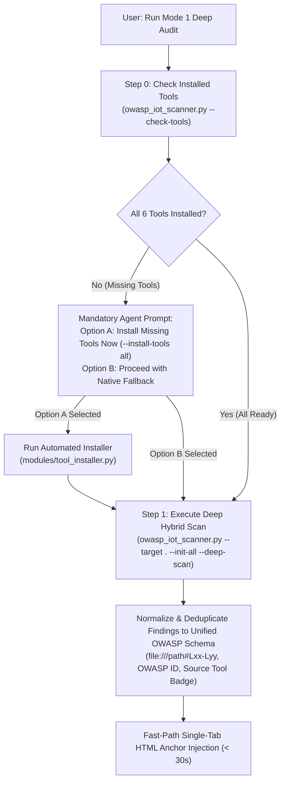
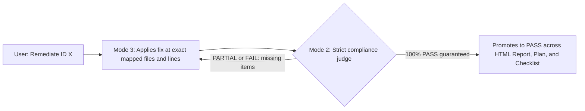

# 🛡️ EmbedSec Auditor — OWASP IoT & Embedded Security Agent

An AI Agent (Skill + Rule) that **audits, re-verifies, and remediates** vulnerabilities in embedded systems and IoT ecosystems using a unified OWASP methodology:

- **OWASP ISTG** — IoT Security Testing Guide (86 test cases)
- **OWASP Embedded Application Security** — embedded code best practices (10 domains + threat modeling)
- **OWASP FSTM** — Firmware Security Testing Methodology *(optional, on-demand)*
- **OWASP ISVS** — IoT Security Verification Standard

Supports ESP-IDF, Arduino, PlatformIO, FreeRTOS, Zephyr, Embedded Linux (Yocto/Buildroot/OpenWrt), bare-metal firmware, as well as data exchange backends/brokers (MQTT, REST, CoAP, WebSockets) and web/mobile interfaces.

> **🌐 Output Defaults:**
> - **Language:** All generated reports, plans, and checklists are written in **English by default** (another language is used only if explicitly requested by the user).
> - **Format:** All outputs are generated as **standalone static HTML pages (`.html`) by default** with a unified top navigation bar and direct anchor links between the **Final Report (`owasp_iot_final_report.html`)**, the **Remediation Plan (`owasp_iot_remediation_plan.html`)**, and the **Progress Checklist (`owasp_iot_progress_checklist.html`)**, so you can open and navigate everything inside **a single browser tab**.

---

## 📦 Repository Structure

```text
.agents/                              ← Agent core
├── rules/
│   └── owasp-iot-agent-rule.md       ← "always_on" rule (Default English + Static HTML + 3 Modes)
└── skills/owasp-iot-auditor/
    ├── SKILL.md                      ← Master skill router & operational overview
    ├── modes/
    │   ├── mode_1_full_audit.md      ← Mode 1.1 (Standard) & Mode 1.2 (Deep Hybrid SAST Audit)
    │   ├── mode_2_targeted_verification.md ← Mode 2 (Strict Compliance Judge)
    │   └── mode_3_targeted_remediation.md  ← Mode 3 (Surgical Remediator & Closed Loop)
    ├── references/
    │   ├── scanner_cli_reference.md  ← Ultra-short CLI flag cheat sheet (zero code-reading)
    │   ├── static_analysis_tools.md  ← External SAST/SCA/Binary catalog & Mode 1.2 architecture
    │   └── verification_rules.md     ← Technical inspection criteria & regexes per module
    ├── resources/
    │   ├── checklist_template.html   ← Static HTML state-tracking checklist (ISTG + EmbeddedAppSec + FSTM)
    │   ├── report_template.html      ← Static HTML "zero-scroll" compliance report template
    │   ├── remediation_tracker_template.html ← Static HTML remediation & re-test plan by OWASP ID
    │   └── semgrep_iot_rules.yaml    ← Bundled offline Semgrep AST ruleset for IoT/Embedded
    └── scripts/
        ├── owasp_iot_scanner.py      ← Lightweight Base CLI Router (~110 lines)
        └── modules/
            ├── html_manager.py       ← Template init, safe anchor injection & Mode 2 locator
            ├── native_scanner.py     ← Single-pass os.scandir discovery, 6.1/6.2 triage & hardware lockdown
            ├── taint_analyzer.py     ← FirmAgent-inspired Source-to-Sink IoT taint analysis
            ├── firmware_inspector.py ← IoTwizz-inspired binary entropy, magic signatures & secret extraction
            ├── sast_orchestrator.py  ← Mode 1.2 runner (Cppcheck, Gitleaks, Semgrep, Flawfinder, Checksec, Trivy, Binwalk)
            └── tool_installer.py     ← Pre-flight tool checker (--check-tools) & installer (--install-tools)
IOT_OWASP/                            ← Upstream reference sources (git submodules of official OWASP repos)
├── embeddedappsec/
├── owasp-fstm/
└── owasp-istg/
```

> [!NOTE]
> The `IOT_OWASP/` folder serves strictly as upstream reference material from which the checklists and rules were consolidated. The agent operates standalone—everything required at runtime is inside `.agents/`.

---

## 🚀 Installation

```bash
git clone --recurse-submodules https://github.com/BrunoReiff/embed-sec-auditor.git
```

Choose how to install the agent:

| Scope | Installation Steps |
| :--- | :--- |
| **Per-Project (Workspace)** | Copy the `.agents/` folder into the root directory of the embedded/IoT project you want to audit. |
| **Global (All Projects)** | Copy `.agents/skills/owasp-iot-auditor` → `~/.gemini/config/skills/` and `.agents/rules/owasp-iot-agent-rule.md` → `~/.gemini/config/rules/`. |

Compatible with AI coding assistants that support the `.agents/` customization standard (Skills + Rules), such as Google Antigravity.

---

## 🧭 Usage — Operational Modes

| Mode | Purpose | Example Prompt |
| :--- | :--- | :--- |
| **Mode 1.1 — Standard Fast Audit** | Fast native single-pass project discovery, Section 6.1 classification, 6 OWASP test modules, and Static HTML Final Report + Linked Remediation Plan | *"Audit this project with the owasp-iot-auditor skill"* |
| **Mode 1.2 — Deep Hybrid Audit (`Full-Power SAST`)** | **100% of Mode 1.1 PLUS 6 External SAST Tools** (*Cppcheck*, *Gitleaks*, *Semgrep*, *Flawfinder*, *Checksec*, *Trivy*). Runs tool readiness check first and offers one-click automated installation (**Option A**) | ***"Run Mode 1 Deep Audit on this project"*** or ***"Execute Full-Power OWASP Audit"*** |
| **Mode 2 — Targeted ID Verification** | Re-test specific OWASP IDs as a strict compliance judge | *"Verify ID `ISTG-FW-SCRT-003`"* or *"Re-test `EMB-APPSEC-01`"* |
| **Mode 3 — Targeted ID Remediation** | Fix specific OWASP IDs with automated closed-loop verification | *"Remediate OWASP IDs `EMB-APPSEC-01` and `ISTG-DES-CRYPT-001`"* |

> To include the 9 stages of **OWASP FSTM** (binary extraction, emulation, and runtime analysis), explicitly ask: *"...including Part C (FSTM)"*.

---

## 🔬 Mode 1.2: Multi-Tool SAST Suite & Graceful Degradation

In **Mode 1.2 (Deep Hybrid Audit)**, the agent orchestrates 6 industry-standard static analysis tools alongside the native OWASP reasoning engine:

| Tool | Core Domain | OWASP Module Focus | Execution Speed | Graceful Fallback |
| :--- | :--- | :--- | :--- | :--- |
| **Cppcheck** | Deep C/C++ AST & Flow SAST | Modules 1 & 3 (Memory, Buffers, Logic) | 2 – 8 sec | Native tree search + LLM |
| **Gitleaks** | Secrets & Hardcoded Keys | Module 2 (`ISTG-FW-SCRT-*`) | < 2 sec | Native regex scanner + LLM |
| **Semgrep OSS** | IoT API Patterns & Insecure Calls | Modules 1, 2, 4 (OTA), 5 (DES) | 3 – 10 sec | Bundled [`semgrep_iot_rules.yaml`](.agents/skills/owasp-iot-auditor/resources/semgrep_iot_rules.yaml) |
| **Flawfinder** | Lexical C/C++ Buffer Linter | Module 1 (`EMB-APPSEC-01/02`) | < 1 sec | Native regex scanner + LLM |
| **Checksec** | ELF Binary Mitigations (`NX`, `Canary`, `PIE`, `RELRO`) | Module 3 (`ISTG-FW-INFO-004`) | < 1 sec | **Built-in Pure-Python ELF Parser** in `sast_orchestrator.py` |
| **Trivy** | Software Composition Analysis (SCA) | Module 6 (`ISTG-*-CONF-001` SBOM/CVE) | 5 – 15 sec | Manifest dependency parser + LLM |
| **Binwalk / FW Inspector** | Binary Entropy, Magic Signatures & Secret Strings | Modules 2 & 3 (`ISTG-FW[INST]-CRYPT-002`) | < 2 sec | **Built-in Pure-Python Engine** in `firmware_inspector.py` |
| **FirmAgent Taint Engine** | Intraprocedural Source-to-Sink Taint Chains | Module 1 (`EMB-APPSEC-01/02`) | < 1 sec | **Built-in Pure-Python Engine** in `taint_analyzer.py` |



---

## ⚙️ How the Agent Operates

### Mode 1 — Full / Incremental Audit (Mode 1.1 Standard & Mode 1.2 Deep Hybrid SAST)

0. **Pre-Flight Tool Check & Interactive Installer (Mode 1.2 Exclusive)** — When Mode 1.2 is invoked, the agent runs `--check-tools`. If any tools are missing, the agent asks the user if they want to install them automatically (**Option A:** `--install-tools all`) before scanning.
1. **General Project Discovery** — Inventories programming languages, RTOS/OS/SDKs, hardware interfaces, build systems, cryptographic libraries, and network/wireless protocols via `owasp_iot_scanner.py`.
2. **Scope Classification (Section 6.1)** — Classifies the project across 4 functional categories (*Firmware/Embedded Code*, *Build System/Firmware Image*, *Backend/Broker/Data Services*, *Web/Mobile/User & Physical Interfaces*) and marks out-of-scope components as `N/A`.
3. **State-Tracking HTML Checklist** — Initializes or resumes `owasp_iot_progress_checklist.html`, tracking **where the agent stopped and where it must go next** so large audits can be paused and resumed seamlessly.
4. **Sequential Testing (Section 6.2)** — Executes 6 test modules in strict order, always recording the **exact file(s) and line number(s)** (`file:///path#L10-L20`) and tool badge of every finding:
   1. **Module 1:** Embedded SAST & Memory Quality *(Native + Cppcheck + Flawfinder + Semgrep)*
   2. **Module 2:** Secrets, Identity & Cryptography *(Native + Gitleaks + Semgrep)*
   3. **Module 3:** Build, Bootloader & Binary Hardening *(Native + Checksec / Pure-Python ELF Inspector + Cppcheck)*
   4. **Module 4:** Firmware Update Lifecycle / OTA *(Native + Semgrep)*
   5. **Module 5:** Data Exchange Services & Business Logic *(Native + Semgrep)*
   6. **Module 6:** SBOM & Third-Party Dependencies *(Native + Trivy SCA)*
5. **Single-Tab Static HTML Output (Report + Linked Remediation Plan)** — Generates cross-linked static HTML files in the audited project:
   - `owasp_iot_final_report.html` — **Zero-scroll** compliance report strictly grouped by status (**`FAIL` first**, then `PARTIAL`, `PASS`, and `N/A`), with a clickable quick-navigation dashboard at the top and a direct **🛠️ Open in Remediation Plan** link on every `FAIL`/`PARTIAL` row.
   - `owasp_iot_remediation_plan.html` — Linked directly from the report in the same browser tab; contains actionable task cards for every `FAIL` and `PARTIAL` item with exact file/line locations and one-click **Copy** buttons for Mode 3 commands, external developer prompts, and Mode 2 re-verification commands.

### Mode 2 ⇄ Mode 3 — Closed-Loop Remediation & Verification



- **Mode 3 never self-approves (`PASS`)** — After applying a fix, it immediately invokes Mode 2 to audit the change.
- **Mode 2 never assumes `PASS` automatically** — If a fix is incomplete (`PARTIAL` or `FAIL`), Mode 2 records **exact missing items (files & lines)** and invokes Mode 3 back.
- The **closed loop (`Mode 3` ⇄ `Mode 2`)** repeats until Mode 2 guarantees 100% compliance (`PASS`) and synchronizes all three HTML files.

---

## ⚡ CLI Flags Quick Reference (Zero Code-Reading)

```bash
# Mode 1.1: Standard Fast Native Audit
python3 .agents/skills/owasp-iot-auditor/scripts/owasp_iot_scanner.py --target . --init-all

# Mode 1.2 Step 0: Check Installed SAST Tools
python3 .agents/skills/owasp-iot-auditor/scripts/owasp_iot_scanner.py --check-tools

# Mode 1.2 Step 0b: Install Missing Tools (Option A)
python3 .agents/skills/owasp-iot-auditor/scripts/owasp_iot_scanner.py --install-tools all

# Mode 1.2 Step 1: Run Deep Hybrid Audit (Native + 6 SAST Tools)
python3 .agents/skills/owasp-iot-auditor/scripts/owasp_iot_scanner.py --target . --init-all --deep-scan

# Mode 2: Targeted ID Locator
python3 .agents/skills/owasp-iot-auditor/scripts/owasp_iot_scanner.py --target . --verify-id <OWASP_ID>

# Safe HTML Anchor Injection (Preserves Immutable Skeleton)
python3 .agents/skills/owasp-iot-auditor/scripts/owasp_iot_scanner.py \
  --target . \
  --inject-target report \
  --inject-anchor INSERT_FAIL_ROWS_HERE \
  --inject-content-file path/to/snippet.html
```

*(See [`scanner_cli_reference.md`](.agents/skills/owasp-iot-auditor/references/scanner_cli_reference.md) for the full cheat sheet).*

---

## ⚠️ Disclaimer

This agent primarily performs static and configuration analysis (source code, build configs, manifests, and firmware artifacts). It complements—but does not replace—physical hardware penetration testing (e.g., live fault injection or side-channel oscilloscopes). Use only on projects and devices you are authorized to test.

## 📚 Credits

Methodology built upon official OWASP projects: [OWASP ISTG](https://github.com/OWASP/owasp-istg), [OWASP Embedded Application Security](https://github.com/scriptingxss/embeddedappsec), and [OWASP FSTM](https://github.com/scriptingxss/owasp-fstm). See each submodule for its respective license.
