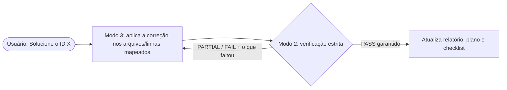

# 🛡️ OWASP IoT Auditor — Agente de Segurança para Sistemas Embarcados e IoT

Agente de IA (Skill + Rule) que **audita, retesta e corrige** vulnerabilidades em projetos embarcados/IoT com base na metodologia OWASP unificada:

- **OWASP ISTG** — IoT Security Testing Guide (86 casos de teste)
- **OWASP Embedded Application Security** — boas práticas de código embarcado
- **OWASP FSTM** — Firmware Security Testing Methodology *(opcional)*
- **OWASP ISVS** — IoT Security Verification Standard

Funciona com ESP-IDF, Arduino, PlatformIO, FreeRTOS, Zephyr, Linux embarcado (Yocto/Buildroot/OpenWrt), bare-metal, além de backends/brokers (MQTT, REST, CoAP) e painéis web.

---

## 📦 Estrutura do repositório

```text
.agents/                              ← núcleo do agente
├── rules/
│   └── owasp-iot-agent-rule.md       ← regra "always_on": define os 3 modos de chamada
└── skills/owasp-iot-auditor/
    ├── SKILL.md                      ← instruções completas do agente
    ├── references/
    │   └── verification_rules.md     ← critérios técnicos/regex por módulo
    ├── resources/
    │   ├── checklist_template.md     ← checklist de estado (ISTG + EmbeddedAppSec + FSTM)
    │   ├── report_template.md        ← relatório final "zero scroll"
    │   └── remediation_tracker_template.md ← plano de resolução por ID OWASP
    └── scripts/
        ├── owasp_iot_scanner.ps1     ← sondagem/triagem (Windows)
        └── owasp_iot_scanner.py      ← sondagem/triagem (Linux/macOS)
IOT_OWASP/                            ← apenas FONTE (git submodules dos repositórios oficiais OWASP)
├── embeddedappsec/
├── owasp-fstm/
└── owasp-istg/
```

> [!NOTE]
> A pasta `IOT_OWASP/` serve só como material de referência de onde os checklists foram consolidados. O agente funciona sem ela — todo o conteúdo necessário já está em `.agents/`.

---

## 🚀 Instalação

```bash
git clone --recurse-submodules https://github.com/<seu-usuario>/<este-repo>.git
```

Escolha uma das formas:

| Escopo | Como instalar |
| :--- | :--- |
| **Por projeto** | Copie a pasta `.agents/` para a raiz do projeto embarcado que será auditado. |
| **Global (todas as máquinas/projetos)** | Copie `.agents/skills/owasp-iot-auditor` → `~/.gemini/config/skills/` e `.agents/rules/owasp-iot-agent-rule.md` → `~/.gemini/config/rules/`. |

Compatível com agentes que leem o padrão `.agents/` (Skills + Rules), como o Google Antigravity.

---

## 🧭 Como usar — os 3 modos

| Modo | Para quê | Exemplo de prompt |
| :--- | :--- | :--- |
| **1 — Auditoria completa** | Mapear o projeto inteiro e gerar relatório + plano de correção | *"Audite este projeto com a skill owasp-iot-auditor"* |
| **2 — Verificação por ID** | Retestar um item específico (juiz estrito) | *"Verifique o ID `ISTG-FW-SCRT-003`"* |
| **3 — Resolução por ID** | Corrigir itens específicos com verificação automática | *"Solucione os IDs `EMB-APPSEC-01` e `ISTG-DES-CRYPT-001`"* |

> Para incluir os 9 estágios do **FSTM** (extração/emulação de firmware), peça explicitamente: *"...incluindo a Parte C (FSTM)"*.

---

## ⚙️ Como o agente opera

### Modo 1 — Auditoria completa (5 etapas)

1. **Sondagem** — inventaria linguagens, RTOS/SDK, hardware, build, criptografia e protocolos (com apoio do script `owasp_iot_scanner`).
2. **Classificação de escopo (Seção 6.1)** — enquadra o projeto em 4 categorias (Firmware · Build/Imagem · Backend/Broker · UI/Web/Mobile) e marca o que não se aplica como `N/A`.
3. **Checklist de estado** — cria/retoma `owasp_iot_checklist_progresso.md`, que registra **onde o agente parou e para onde vai**. Auditorias longas podem ser retomadas a qualquer momento.
4. **Testes em ordem fixa (Seção 6.2)** — 6 módulos, sempre registrando **arquivo e linha exatos** de cada achado:
   1. SAST embarcado e memória (funções banidas, injeção, stack overflow)
   2. Segredos, identidade e criptografia (hardcoded secrets, TLS/mTLS, armazenamento seguro)
   3. Hardening de build, bootloader e binários (flags, Secure Boot, JTAG, logs UART)
   4. Atualização de firmware/OTA (assinatura, transporte seguro, anti-rollback)
   5. Serviços de dados e lógica de negócio (ACL MQTT, anti-replay, rate-limit)
   6. SBOM e dependências (versões fixadas, CVEs)
5. **Saída** — gera dois arquivos no projeto auditado:
   - `owasp_iot_relatorio_final.md` — relatório "zero scroll": **FAIL primeiro**, depois PARTIAL, PASS e N/A, com índice clicável.
   - `owasp_iot_plano_resolucao.md` — um card por falha com local exato, prompt pronto para correção e comando de reteste.

### Modos 2 ⇄ 3 — Loop fechado de correção



- O **Modo 3 nunca marca `PASS`** sozinho — sempre entrega ao Modo 2.
- O **Modo 2 nunca assume `PASS`** — se faltar algo, devolve ao Modo 3 a lista exata do que falta (arquivo/linha).
- O loop se repete até o Modo 2 garantir 100% de conformidade. Só então os 3 arquivos são atualizados.

---

## 🔧 Scripts auxiliares (uso manual opcional)

```powershell
# Windows
powershell -ExecutionPolicy Bypass -File .agents/skills/owasp-iot-auditor/scripts/owasp_iot_scanner.ps1 -TargetDir <projeto> -InitChecklist
```

```bash
# Linux / macOS
python3 .agents/skills/owasp-iot-auditor/scripts/owasp_iot_scanner.py --target <projeto> --init-checklist
```

Use `-VerifyId <ID>` / `--verify-id <ID>` para localizar rapidamente um ID nos arquivos de saída.

---

## ⚠️ Aviso

A análise é majoritariamente estática (código, configuração e build). Ela não substitui um pentest com acesso ao hardware físico. Use somente em projetos que você tem autorização para avaliar.

## 📚 Créditos

Metodologia baseada nos projetos oficiais da OWASP: [ISTG](https://github.com/OWASP/owasp-istg), [Embedded AppSec](https://github.com/scriptingxss/embeddedappsec) e [FSTM](https://github.com/scriptingxss/owasp-fstm). Consulte as licenças originais em cada submódulo.

