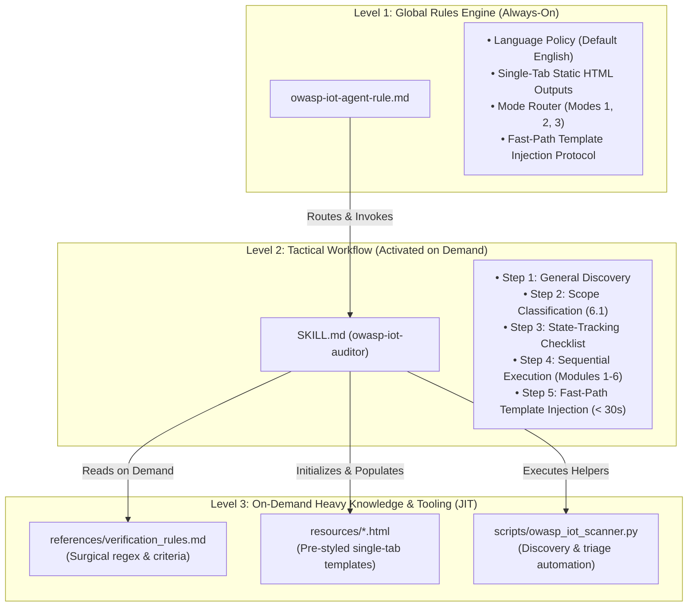

# Strategic Work Plan — 3-Tier OWASP IoT & Embedded Security Auditor Agent

> [!NOTE]
> **Architecture Baseline:** This work plan operationalizes, benchmarks, and maintains the 3-Tier Agent Architecture for embedded systems and IoT security auditing, following the unified OWASP standard (Embedded AppSec, ISTG, ISVS, and FSTM).

---

## 1. Executive Summary & Architectural Overview

The agent is decoupled into three distinct operational layers to minimize context load, reduce token cost, and guarantee deterministic, sub-30-second audit artifact generation:



---

## 2. Work Plan Milestones & Roadmap

| Milestone | Objective | Deliverables | Status |
| :--- | :--- | :--- | :--- |
| **M1: Architecture Baseline & Boundary Enforcement** | Ensure strict isolation between Levels 1, 2, and 3 with modular mode files (`mode_1_full_audit.md`, `mode_2_targeted_verification.md`, `mode_3_targeted_remediation.md`) and a lean Master Router `SKILL.md`. | Modular mode documents, Master Router `SKILL.md` (~5 KB), updated `owasp-iot-agent-rule.md`, and anchor tags. | **Completed** |
| **M2: Synthetic Testbed & Mock Project** | Create a deterministic test suite containing deliberate vulnerabilities across all 6 modules. | `tests/fixtures/mock_iot_device/` with vulnerable C/C++, headers, configs, and OTA code. | **Next (Sprint 1)** |
| **M3: End-to-End Functional Validation** | Verify Mode 1, Mode 2, and Mode 3 execution flows against the synthetic testbed. | Automated test run logs, validated HTML reports, and closed-loop Mode 2 $\leftrightarrow$ Mode 3 cycle. | **Sprint 2** |
| **M4: Benchmarking & Latency Profiling** | Measure token consumption, execution latency, and template population duration. | Benchmark report confirming template population < 30s and zero formatting bugs. | **Sprint 2** |
| **M5: Production Release & Continuous Sync** | Finalize release documentation, enforce auto-sync rules, and package as installable plugin. | Synchronized global config (`~/.gemini/config/`), GitHub `main` branch, tag release. | **Sprint 3** |

---

## 3. Detailed Work Breakdown Structure (WBS)

### Phase 1: Synthetic Testbed Construction (`mock_iot_device`)

To test the auditor without risk to production hardware, create a self-contained simulated IoT firmware project containing intentional flaws mapped to the 6 modules of Section 6.2:

```
tests/fixtures/mock_iot_device/
├── CMakeLists.txt              # Build configuration with disabled hardening flags
├── sdkconfig                   # ESP-IDF config with disabled Secure Boot & Anti-Rollback
├── platformio.ini              # PlatformIO config with unpinned/outdated libraries
├── include/
│   ├── config.h                # Hardcoded Wi-Fi/MQTT credentials and private key
│   └── ota_update.h            # Firmware update function signatures
└── src/
    ├── main.c                  # Module 1: Unsafe strcpy/sprintf in UART parser
    ├── network.c               # Module 2: TLS verification bypassed (setInsecure)
    ├── debug_console.c         # Module 3: Verbose UART logging leaking secrets
    ├── ota_handler.c           # Module 4: Unauthenticated OTA routine without signature check
    └── mqtt_client.c           # Module 5: Wildcard topic '#' subscription, anonymous broker
```

#### Acceptance Criteria for Phase 1:
- [ ] At least 1 deliberate vulnerability per module (total &ge; 6 distinct flaws).
- [ ] Clear expected verdicts (`FAIL` for missing controls, `PARTIAL` for incomplete checks, `PASS` for verified safe functions).

---

### Phase 2: Mode-by-Mode Rigorous Validation

#### 2.1. Mode 1: Full Project Audit Verification
1. **Discovery & Classification (High-Speed Tree Search):**
   - Execute `python3 .agents/skills/owasp-iot-auditor/scripts/owasp_iot_scanner.py --target tests/fixtures/mock_iot_device --init-all`.
   - Verify single-pass recursive tree search execution (`os.scandir` with early directory pruning and size limits), achieving sub-second response time.
   - Verify that Section 6.1 correctly classifies Categories 1 (Embedded Code) and 2 (Build System).
2. **Sequential Module Execution:**
   - Verify Modules 1 through 6 in strict sequence.
   - Confirm every detected vulnerability records exact file and line ranges (`file:///.../src/main.c#L42-L48`).
3. **Fast-Path HTML Generation (< 30s) & Immutable Skeleton Enforcement:**
   - **Strictly Immutable HTML Structure & Anchor Preservation:** Confirm that the agent modifies ONLY content at the explicit anchors (`<!-- ANCHOR: ... -->`), **always preserving the anchor comments** during single-batch or incremental replacements (or via `owasp_iot_scanner.py --inject-anchor`), toggles checkboxes, and updates status badges/KPI counters. Under NO circumstances may the agent alter `<head>`, `<style>`, `<nav>`, `<section>`, `<thead>`, or `<script>` tags.
   - Confirm NO full file rewrites occur.
   - Verify all navigation links between reports work inside a single browser tab.

#### 2.2. Mode 2: Targeted Re-verification Protocol
1. **Targeted Verification Call:**
   - Invoke: `"Verify ID ISTG-FW-SCRT-003"`.
2. **Behavioral Checks:**
   - Verify the agent does **NOT** rescan the entire project.
   - Verify the agent inspects only `include/config.h` and referenced lines.
   - If hardcoded strings still exist, verify the agent returns `FAIL`/`PARTIAL` and does **NOT** mark `PASS`.

#### 2.3. Mode 3: Closed-Loop Remediation & Re-test
1. **Targeted Remediation Call:**
   - Invoke: `"Remediate OWASP IDs EMB-APPSEC-01 and ISTG-FW-SCRT-003"`.
2. **Closed-Loop Execution:**
   - Mode 3 modifies `src/main.c` (replacing `strcpy` with bounded `snprintf`) and moves secrets from `include/config.h` to encrypted NVS storage.
   - Mode 3 triggers Mode 2 to audit the patch.
   - Only when Mode 2 issues `PASS` are the items moved from Section 1 (`FAIL`) to Section 3 (`PASS`) in `owasp_iot_final_report.html`, checkboxes marked as checked (`<input type="checkbox" checked>`), and logged in `owasp_iot_remediation_plan.html#tbody-resolved-history`.

---

## 4. Key Performance Indicators (KPIs) & Quality Gates

| Metric | Target Threshold | Measurement Method |
| :--- | :--- | :--- |
| **Template Population Latency** | **< 30 seconds** | Time elapsed between completion of Module 6 and final HTML output. |
| **HTML Integrity** | **100% Valid Syntax** | Zero corrupted CSS styles, broken tables, or unclosed HTML tags. |
| **Traceability Precision** | **100% of Findings** | Every `FAIL` and `PARTIAL` item must include clickable `file:///` and `#Lxx-Lyy` links. |
| **Token Efficiency** | **> 70% Reduction** | Level 1 stays under 1,500 tokens; Level 3 loaded only during active checks. |
| **Single-Tab Navigation** | **Zero Dead Links** | All internal cross-links (`report` $\leftrightarrow$ `plan` $\leftrightarrow$ `checklist`) functional. |

---

## 5. Maintenance & Release Protocol

> [!IMPORTANT]
> **Continuous Synchronization Policy:**
> Per `GEMINI.md` and `local-sync-rule.md`, any future modification to rules, skills, templates, or scripts must:
> 1. Sync automatically to `C:\Users\Admin\.gemini\config\rules\` and `C:\Users\Admin\.gemini\config\skills\`.
> 2. Be staged, committed with semantic convention, and pushed to `origin main` on GitHub.

