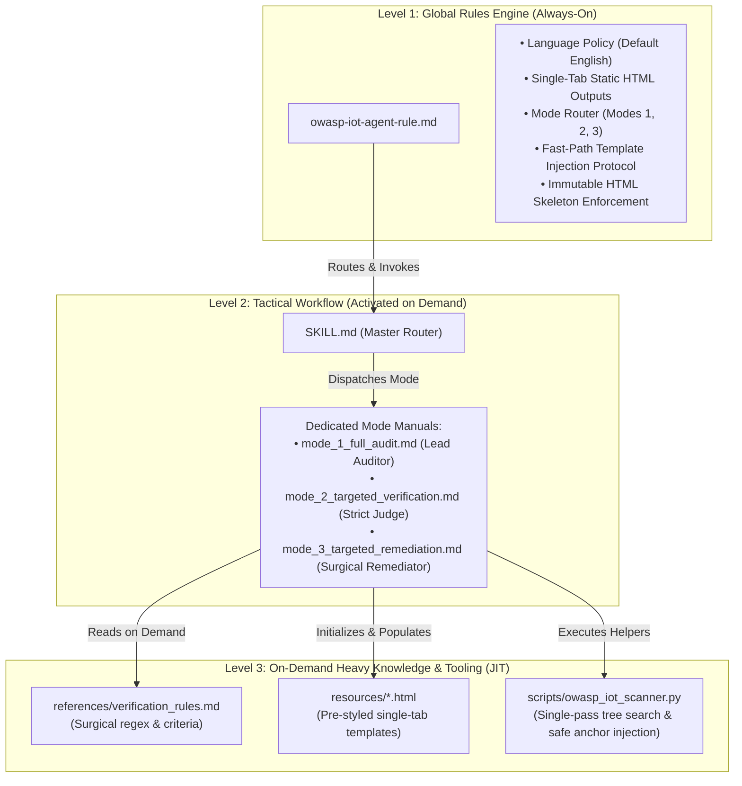

# Strategic Work Plan — OWASP IoT & Embedded Security Auditor Agent

> [!NOTE]
> **Core Objective:** The purpose of this project is NOT to build a software testing framework with mock fixtures, but rather to build an autonomous AI Security Auditor Agent that inspects real-world embedded and IoT codebases, pinpoints security flaws according to the unified OWASP standards, and organizes findings clearly for the user in actionable, single-tab static HTML interfaces.

---

## 1. Executive Summary & 3-Tier Architecture

The system decouples knowledge and instructions into 3 operational layers to guarantee ultra-fast response times, zero token waste, and deterministic report generation:

---

## 2. Agent Delivery Roadmap & Milestones

| Milestone | Objective | Deliverables | Status |
| :--- | :--- | :--- | :--- |
| **M1: Modular 3-Tier Architecture** | Decouple the monolithic skill into specialized mode instructions and a lightweight Master Router. | `SKILL.md` (~5 KB), `modes/mode_1_full_audit.md`, `modes/mode_2_targeted_verification.md`, and `modes/mode_3_targeted_remediation.md`. | **Completed** |
| **M2: Fast-Path Template Engine & Safe Injection** | Enable instant (< 30s) template population with strict anchor preservation and 100% immutable HTML structure. | Anchor-preserving injection in `owasp_iot_scanner.py`, explicit anchor comments in templates, and anchor preservation protocols. | **Completed** |
| **M3: Real-World Audit Readiness & Polish** | Verify agent readiness across common embedded ecosystems (ESP-IDF, Arduino, PlatformIO, Zephyr, Embedded Linux) when executed by user prompts. | Auditing guidelines, single-tab cross-link validation, and zero-dead-links verification. | **Active / Ready** |
| **M4: Continuous Sync & Deployment** | Enforce machine-wide synchronization and version control. | Automated sync to `~/.gemini/config/` and clean remote repository on GitHub `origin main`. | **Completed** |

---

## 3. Operational Workflow for Real-World Audits

### 3.1. Mode 1 — Full Project Audit & Error Organization
1. **Target Inspection:** The user points the agent to an embedded codebase (e.g. *"Audit this project with the owasp-iot-auditor skill"*).
2. **Instant Initialization:** The agent initializes the 3 static HTML tracking files in 5ms via `python3 .../owasp_iot_scanner.py --target <path> --init-all`.
3. **Tree Search Discovery & Scope (Section 6.1):** High-speed single-pass tree search classifies whether Firmware (1), Build (2), Backend (3), or Web UI (4) are present.
4. **Sequential Evaluation (Section 6.2):** Evaluates Modules 1 to 6 in strict order, mandatorily recording exact file and line ranges (`file:///abs/path#Lxx-Lyy`) for every finding.
5. **Organized Single-Tab Output:** Populates `owasp_iot_final_report.html`, `owasp_iot_remediation_plan.html`, and `owasp_iot_progress_checklist.html` without modifying the HTML skeleton, placing critical FAIL items first for zero-scroll visibility.

### 3.2. Mode 2 — Targeted Re-verification (Strict Judge)
1. Triggered on specific IDs (e.g. *"Verify ID ISTG-FW-SCRT-003"*).
2. Does NOT rescan the project; inspects only the affected files and lines against `verification_rules.md`.
3. If gaps remain, records delta missing items and commands Mode 3 in a closed loop.
4. When 100% compliant, promotes to PASS and toggles checkboxes.

### 3.3. Mode 3 — Targeted Remediation (Surgical Patching)
1. Triggered to fix specific IDs (e.g. *"Remediate OWASP ID EMB-APPSEC-01"*).
2. Applies minimal, non-breaking patches strictly at mapped locations.
3. Automatically hands off to Mode 2 to audit the patch in a closed loop until Mode 2 guarantees PASS.

---

## 4. Key Performance Indicators (KPIs) & Quality Gates

| Metric | Target Threshold | Measurement Method |
| :--- | :--- | :--- |
| **Template Population Latency** | **< 30 seconds** | Time elapsed between completion of Module 6 and final HTML output. |
| **HTML Integrity** | **100% Valid Syntax** | Zero corrupted CSS styles, broken tables, or unclosed HTML tags. |
| **Traceability Precision** | **100% of Findings** | Every `FAIL` and `PARTIAL` item must include clickable `file:///` and `#Lxx-Lyy` links. |
| **Token Efficiency** | **> 70% Reduction** | Level 1 stays under 1,500 tokens; Level 3 loaded only during active checks. |
| **Single-Tab Navigation** | **Zero Dead Links** | All internal cross-links (`report` $\leftrightarrow$ `plan` $\leftrightarrow$ `checklist`) functional. |

---

## 5. Maintenance & Release Protocol

> [!IMPORTANT]
> **Continuous Synchronization Policy:**
> Per `GEMINI.md` and `local-sync-rule.md`, any future modification to rules, skills, templates, or scripts must:
> 1. Sync automatically to `C:\Users\Admin\.gemini\config\rules\` and `C:\Users\Admin\.gemini\config\skills\`.
> 2. Be staged, committed with semantic convention, and pushed to `origin main` on GitHub.
